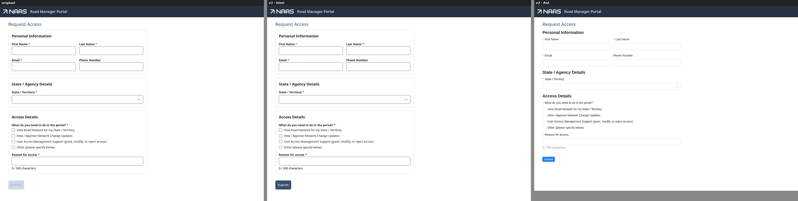
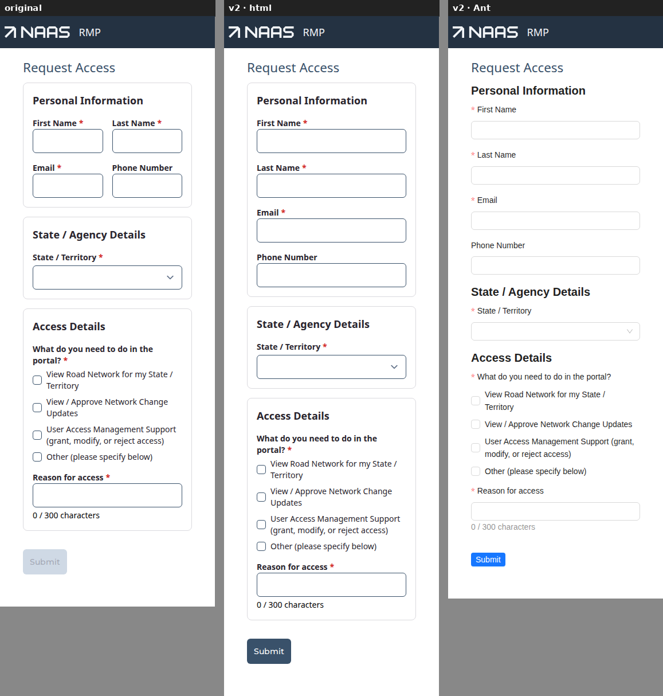
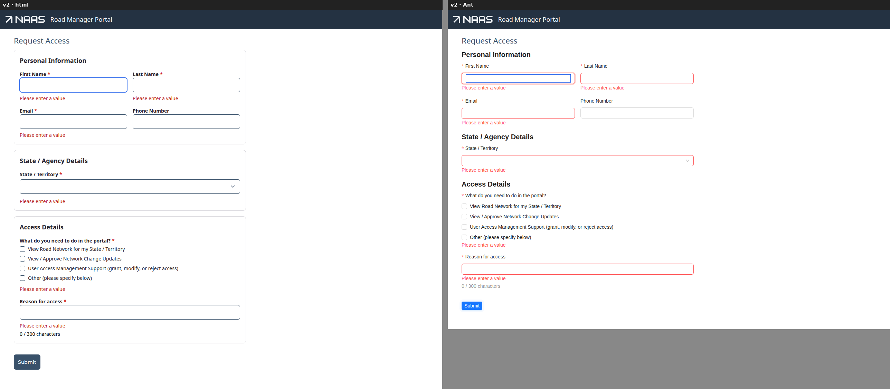
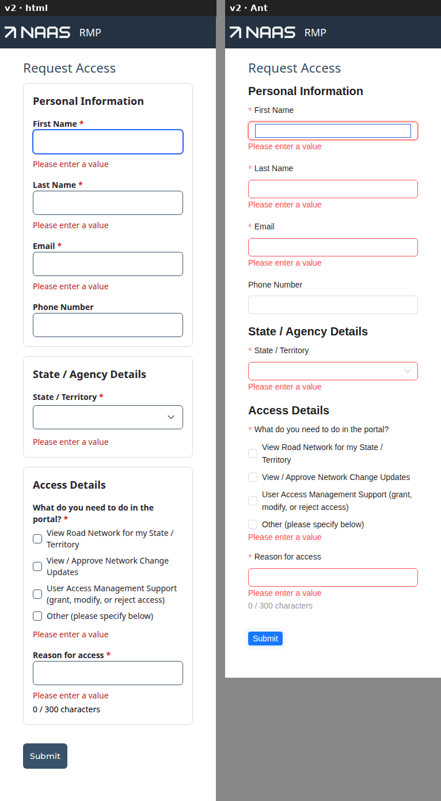
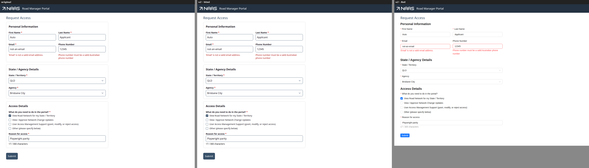
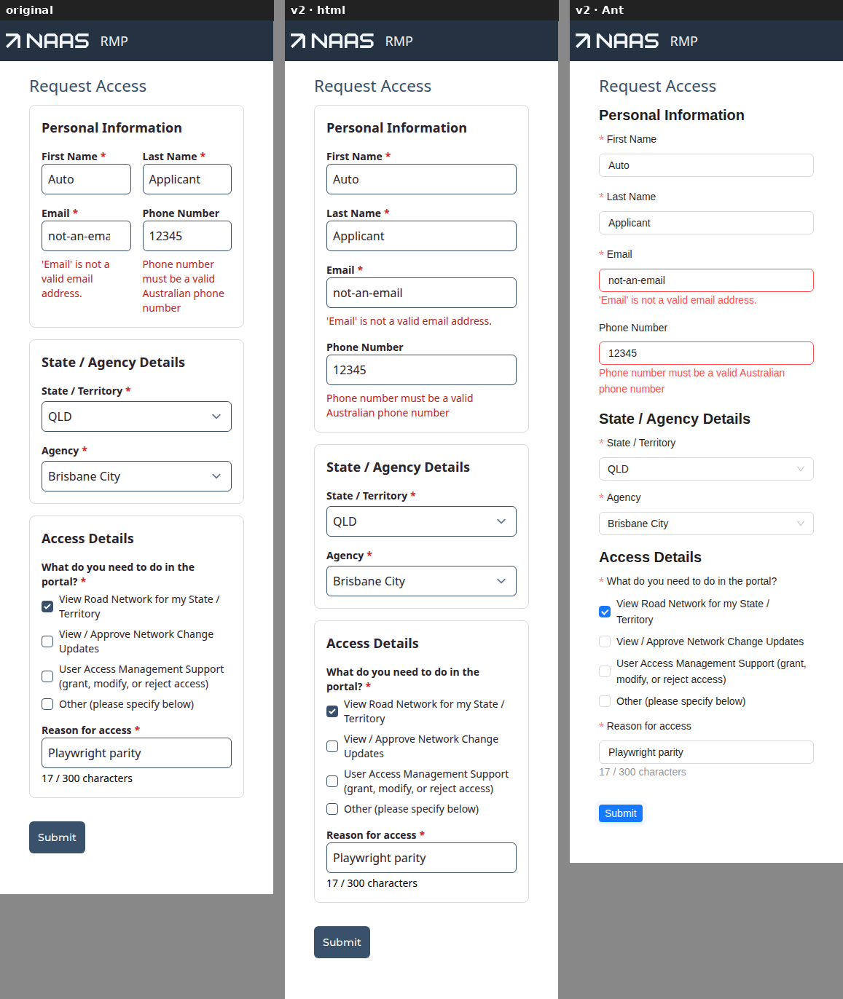
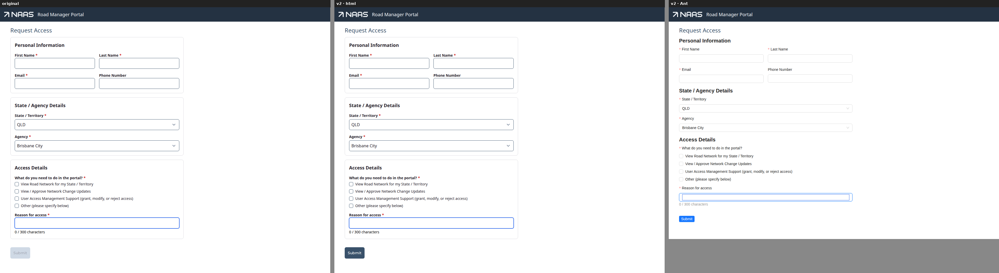
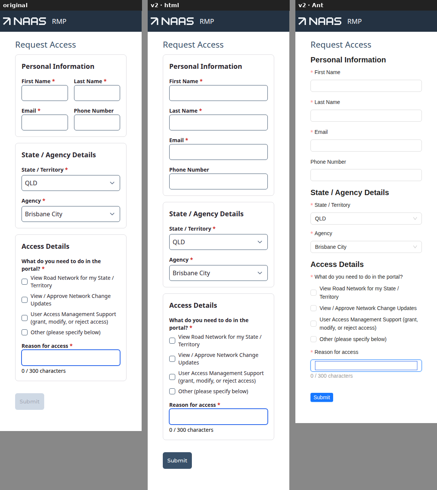
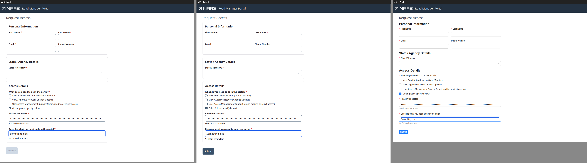
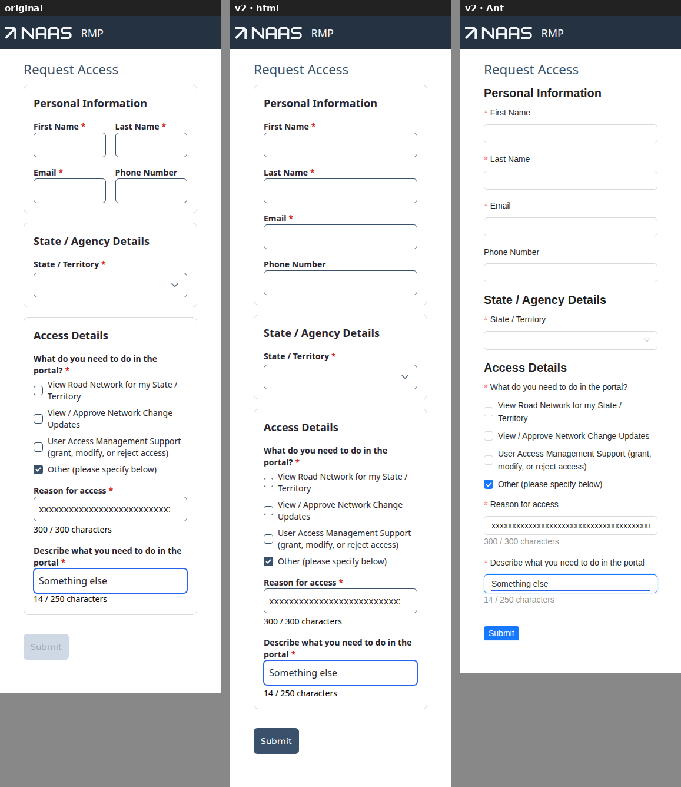

# Forms v2 — the HVAMS Request Access trial, `0.1.0-alpha.9`

The HVAMS **Request Access** form (`/requestAccess`, a guest route) converted to Forms v2 against
`@rx-controls/forms-*@0.1.0-alpha.9` (npm's `alpha` tag), drawn by `forms-html` styled to look like
the original, then mounted unchanged under `forms-antd`. Gaps are numbered **S1** onwards.

HVAMS worktree `~/astrolabe/hvams-formsv2-a9` (the repository is the checkout at
`~/astrolabe/naasv3`), branch `trial/forms-v2-alpha9-request-access` from `develop` at
`babeb7df5`. Throwaway and not pushed:
- `36abfa68b`: the engine bump, and the Forms v2 packages added.
- `2288b7ff1`: the conversion, the HVAMS modules, the specs, and the scaffolding (marked `TEMP`).

rxc: nothing changed. Lines are cited at the release commit `0f815fe`
(`@rx-controls/forms-react_v0.1.0-alpha.9`). HVAMS paths are relative to
`HVAMS.RoadManager.Server/ClientApp`. The screenshots are in
[`forms-v2-hvams-0.1.0-alpha.9/`](./forms-v2-hvams-0.1.0-alpha.9/).

**Verdict.**
- **The form is written against the contract alone, with one effect left, and that effect loads
  data.** The form files import `@rx-controls/forms-react`, compat, and HVAMS's non-UI code, with
  no class name anywhere. Every behaviour the original wrote as an effect or a computed control is
  now a prop:
  - the email prefill is `defaultValue`;
  - the agency reset and clear are `restrictToOptions` with `defaultValue`;
  - the description's clearing is `hidden` with `clearHidden` and `clearTo={null}`;
  - the Submit gate is `check()`;
  - the busy lock is the `Action`'s own.
- **Visual parity came from a theme alone: no `FormRenderers` override.** A partial theme over
  `tailwindHtmlTheme` carries @astrolabe/ui's classes: 84 lines, three of them looks. At 1280
  and 375 px, every probed element matches the original's computed font, weight, colour, border,
  radius, padding and box, except where the brief asked for a change (§4).
- **The layout survives the swap, at 41 lines of Ant looks, and would cost the same again for
  a third implementation.** Under Ant with nothing else, Ant warns once per name (`page`,
  `column`, `twoColumns`) and draws the base look: the form degrades, it doesn't break. But a
  real app hides that warning. Ant's groups read **html's** looks through html's shared region,
  so under this app's root theme the layout "held" with no Ant module at all (S1).
- **Every check that found bugs before passes, under html and Ant**:
  - a server 400 shows under its field and in its accessible description, clears on edit, and
    survives a bare `validate={() => null}`;
  - every control and the check list have a name and a description;
  - section titles are headings;
  - the hidden grid cell closes;
  - Enter refuses an empty form and posts a valid one once;
  - the submit error is `role="alert"` and the counter is not;
  - the colours are right under html.
- **The three HVAMS specs pass** (14 tests): request-access, guest-routes and
  modify-access-request-submission. The modify spec's 409s did not recur.

## 1. Gaps in the contract

What the form needed, and where the contract gave it:

| requirement | contract | effect / widget / look written |
|---|---|---|
| text fields keep `autoComplete`, `required` | `TextField` props | none |
| State / Agency as selects, Agency hidden until a state | `SelectField`, `hidden={(rc) => !rc.getValue(state)}` | none |
| four personal fields two to a row, one on narrow | `look="twoColumns"` on the `Section` | one look per implementation |
| 300 / 250 cap, error past it, "n / max characters" counter, red past the limit | `maxLength` (the cap and a rule, `builtins.ts:56-73`), `showCount={{ format }}` (`widgets.ts:46-55`), theme `count` / `countOver` (`theme.tsx:110-113`) | none |
| description only with "Other", cleared to the DTO's empty | `hidden`, `clearHidden` on the `Section`, `clearTo={null}` (`field.tsx:96-104`) | none |
| reasons as a set | `CheckListField` (`builtins.ts:131-135`) | none |
| submit only when valid; Enter submits | `<Form onSubmit>` + `<Action submit>` (`scope.tsx:174-182`, `:282-291`) | none |
| 400 / 409 / 429 handling, 409's link | `applyValidationErrors` (HVAMS), `TextDisplay announce tone="error"`, `RichText` + `html` | none |
| agency resets to the state's first | `restrictToOptions` (default) + `defaultValue` (`widgets.ts:142-160`) | none |
| an agency no longer offered is cleared | `restrictToOptions` | none |
| email from `?email=` | `defaultValue={initialEmail}` | none |
| the agency list | — | **the one effect**: `getAgencies()` into a control |

The original had six effects (the data load among them) and three computed controls; the
conversion has the data load. `RequestAccessForm.tsx` went from 254 lines to 207 and
`AccessDetailsSection.tsx` from 90 to 62.

### S1. A library implementation reads html's looks (implementation bug)

> **After the trial: reclassified, and made the rule.** Inheriting html's looks is what an app on
> the web wants: the bug was that only groups did it, and stacked both looks where Ant had its own.
> Every web implementation now draws html's looks for every kind of boundary, a library's own look
> of a name winning whole. See "After the trial" below.

`forms-antd`'s groups draw through `forms-html`'s shared `ContentsRegion` (`antd.tsx:878-896`).
Ant passes it no `looks`, so the region falls back to **the html theme in context**:
`const looks = looksProp ?? htmlTheme.looks` (`shared.tsx:554`, the same at `:737` and `:1119`).
HVAMS puts its html theme at the root (as the brief requires) and nests Ant inside it on the
scaffolding page, so:

- With **no** Ant looks, Ant's groups drew HVAMS's html looks as Tailwind classes. The layout held
  (`page`'s padding, the 672 px column, two to a row) and nothing warned. That is html's layout,
  not Ant's.
- With the HVAMS Ant module too, a group gets **both**: html's classes, and Ant's look as inline
  styles over them (`lookParts(…, styled)` still returns the classes, `shared.tsx:497`).
- Only with the root html module removed did Ant warn about the three names, which is what a
  third implementation's adopter would see.

**What the library should do:** an implementation that draws through the shared region should
pass its own (possibly empty) `looks`, never inherit html's from context; the shared region should
not read `useHtmlTheme()` unless it is html. A test: Ant nested under an html theme that names a
look must warn about that look.

### S2. A theme cannot take away what an outer theme gave (theme gap, small)

`HtmlThemeProvider` merges over the enclosing theme, record by record (`theme.tsx:1018-1031`), so
a look an outer provider names can be restyled but never removed, and there is no reset to a
bare theme. It mattered here only for S1's experiment, which had to edit the root layout. A
`reset` (or `inherit={false}`) on the provider would do it.

### S3. A look table is not checked against the form's names (looks gap)

> **After the trial:** documented, not built — `satisfies Record<keyof FormLooks, HtmlLook>` already
> does it ("Typing a look table" in `FORMS-V2-LOOKS.md`).

`FormLooks` makes a typo **in a form** a compile error. Verified: `look="colum"` fails with
*"Did you mean 'column'?"* (`looks.ts:101-126`). The other side is unchecked. html's
`looks: Record<…> & Record<string, HtmlLook>` (`theme.tsx:275`) and Ant's
`group?: Record<string, AntGroupLook>` (`forms-antd/src/looks.tsx`) accept any key. A theme that
misspells `twoColumns`, or leaves it out, is only a development warning, and S1 can hide even
that. The library should offer a helper typed by the app's names, e.g.
`definePortableLooks<FormLooks>()` or `HtmlLooksFor<keyof FormLooks>`, so each implementation's
module is checked for every name the forms use.

### S4. "N equal columns" has no portable spelling (contract gap)

`twoColumns` had to be written once per implementation:

- **html:** `grid grid-cols-1 gap-4 sm:grid-cols-2`.
- **Ant:** `display: "grid"` with `gridTemplateColumns` as a function of `LookState.width`.

The portable subset can't say it:
- **grid is excluded** by design (`FORMS-V2-LOOKS.md:132`).
- **A flex row can't do it from the parent.** Equal cells need `flexBasis` on each child, and
  "placement belongs to the parent" (`:344-348`) rules out a child style that reaches the item
  past the visibility wrapper.

A row of N equal cells is the most common form layout there is. `FlexLayout` (`group.tsx`)
could take `columns: number | ((s: LookState) => number)`, drawn as a grid on the web and as
wrapped `flexBasis` rows on React Native. A look written that way would then be portable and
written once.

### S5. A heading's look comes only from its level (contract, within reason)

> **After the trial: not a gap.** html lays a heading's `look` over its level's classes
> (`html.tsx:810-818` at `0f815fe`), so `{ control: { replace: "…" } }` on a look draws that one
> heading as body text. Now said in `FORMS-V2-LOOKS.md`.

The original's success message is an `<h1 class="mt-4">`, which drew as plain 14 px text: the
class switches off HVAMS's `h1:not([class])` style. A `TextDisplay heading` takes its level from
the outline, and its look from the theme's `levels[n]`. Getting "a heading that looks like body
text" here means changing every level-2 heading. I left it bold and recorded the difference. The
page object only asks for a heading by name.

### S6. "Reset on every change" is not what `restrictToOptions` does (documented; holds here)

`restrictToOptions` with `defaultValue` resets the agency only when the new state's list **moves
away** from it (`widgets.ts:155-158` says so). The original reset on every state change. They
differ only for an agency offered under two states. The dev database has two states and 131
agencies with no shared name, so the behaviour is identical here and the effect is gone.
Production data was not checked. If it ever shares a name, the old effect comes back.

### S7. A frame slot is shared by every widget's control (theme gap, small)

> **After the trial: fixed.** `HtmlTheme.frameFor`, merged over `frame` per widget, from the new
> `InputFrameProps.widget`.

@astrolabe/ui pads a text input `pr-7` and a select `px-2`. html's theme has per-widget **shell**
slots (`shellFor`, `theme.tsx:79`) but one `frame.input` (`:135-150`) for the input and the
select alike. I wrote `[&:not(select)]:pr-7`. A `frameFor` beside `shellFor` would say it plainly.

### The second host: `ModifyAccessForm`

`AccessDetailsSection` is also the profile page's Modify Access dialog. The section stays one
v2 component for both hosts:
- **The section owns its clearing:** `clearHidden` is on its `Section`, not on the request
  form's `<Form>`.
- **The dialog stays legacy.** `ModifyAccessForm` renders the section inside a `<Form>` with no
  `onSubmit`, so no form element is drawn. Its Submit, its `submissionDisabled` gate ("reasons
  changed" and the rest) and its Radix dialog are unchanged.
- **No provider was needed.** The rmi root layout's `FormProvider` and theme reach into the
  portalled dialog.

The modify spec passes, and its console walk (Other on/off, a 310-character reason) is clean
(`modify-dialog.png`). Its `showDescription` prop is gone, but the dialog still computes its own
for the Submit gate.

## 2. The multi-select

`CheckListField` covered the reasons outright:

- **Came free:** binding `AccessRequestReason[]` straight from the compat control (a string enum
  is a `CheckListValue`), `required` refusing an empty array, a `role="group"` named by the
  question, each checkbox named by its option, the group described by a visually hidden
  "Required" and then its error, and focus on a refused submit.
- **Awkward:** HVAMS keeps options as `[value, label]` tuples (`reasons.ts`, shared with the
  task panel), and the contract wants `{ name, value }`. One `map`. The "Other" option's label
  differs from the shared label table's, which the tuple already handled.
- **Wanted built in:** nothing for this form. The original's hand-drawn checkboxes and `toggleReason` are gone.

## 3. Validation and submit

`check()`, `required`, `maxLength` and the server's errors covered the real form:

- **A refused submit** touches everything and focuses First Name. Every required control is
  described by "Please enter a value" (the four text fields, the State select and the check
  list); Phone is not. Nothing posts. Run by Enter in a text field, under html and Ant.
- **The caps.** Typing stops at 300; a 305-character value arriving anyway (the `maxlength`
  removed) shows "At most 300 characters" and a red "305 / 300 characters". The control's
  description is the error then the count; help would come first, but html hides help while an
  error shows (`html.tsx:233-234`).
- **Server 400s.** `applyValidationErrors` sets each message under `"default"`, and
  `@astroapps/client`'s `pathBasedErrors` sets `touched` on each control it errors. So the
  contract's "a host applying server errors touches the fields it sets them on"
  (`field.tsx:218-221`) already holds. An error on a field the user pressed Enter in and never
  left shows. I first added a touch of my own, found it redundant by removing it, and took it
  out.
- **A bare validator** (`validate={() => null}` on Phone, temporarily) does not hide the server's
  Phone error: it publishes under `default@<id>`, not `default` (`field.tsx:136-144`). The error
  shows, is in the description, and clears on edit, under html and Ant.
- **One mismatch with the contract's advice.** `applyValidationErrors` begins with
  `control.clearErrors()`, which `field.tsx:222-227` warns against: it also wipes the rule errors
  the boundaries published on the data. It has no visible effect here, because fields and
  `check()` read their own verdicts. HVAMS should clear its own `"default"` key instead.
- **409, 429, other.** The 409 is a `TextDisplay announce tone="error"` whose text is a
  `RichText` built with `html\`…\``, the link drawn by the theme's `richText.link`
  (`theme.tsx:393-394`), `target="_blank"` kept. The box is `role="alert"`, never unmounted, and
  empty until it has words (`display.tsx:62-76`).
- **Submit posts once:** `Action submit` is busy while the promise runs, and the original's
  `isSubmitting` guard is gone. Enter on a valid form posts exactly once (`posts: 1`, checked by
  request count).
- **What reaches the server:** after "Other" on, typed into, then off, the body carries
  `"description": null`.

## 4. Visual parity

Captured by a temporary Playwright spec at 1280 and 375 px in each state. Each image is the
original, then v2 under html, then v2 under Ant:

| state | desktop | phone |
|---|---|---|
| empty |  |  |
| refused submit (v2: every required error; the original can't refuse, its Submit is disabled) |  |  |
| server 400 on email and phone (the like-for-like refusal) |  |  |
| state and agency chosen |  |  |
| "Other" with the description, reason at its cap |  |  |

**What the theme alone matched.** The spec also read computed styles and boxes for the same
elements on both pages. Those elements were the h1, a section and its title, a label, a text
input, the State select, a checkbox and its text, the reason input, the counter, Submit and a
server error. Probed properties: font size, weight, family, line height, colour, background,
border width, colour and radius, padding, margin and box shadow. Every one matches except:
- **the counter's 4 px**, now `margin-top` where the original had a wrapper's `gap-1`; it lands in
  the same place;
- **Submit's 16 px**, now on the shell (`shellStyle={{ marginVertical: 16 }}`) where the original
  had `my-4`; same place;
- **Submit's colours:** the original is disabled until the form is filled, and v2 is always
  enabled (as briefed);
- **the phone width:** the original keeps two to a row at 375 px, and v2 stacks (as briefed).

How each part was reached, all as theme slots (`sites/rmi/src/forms/HvamsHtmlForms.tsx`):
- **Text field:** `shell.vertical` with no gap, `shell.label: "font-bold"`, the input's chrome on
  the input itself via `frame.classNameOn: "input"` (`theme.tsx:144-149`), so @tailwindcss/forms'
  own focus ring applies exactly as on the original.
- **Select:** the same frame, with NField's `gap-1` and `text-sm` label through
  `shellFor.select`.
- **Required marker:** `shell.required: { className: "ml-1 text-danger-500", text: "*" }`, the
  original's `::after` as an `aria-hidden` span.
- **Error:** `shell.error: "mt-2 text-sm text-danger-600"`.
- **Counter:** `count` / `countOver`.
- **Check list:** `checkList` slots and `shellFor.checkList`.
- **Section card:** FormSection's classes on `contents.section`, `hideWith: "attribute"` and
  `visibility.transitions: false`, since nothing in HVAMS fades.
- **Button:** `buttonVariants` default as the `primary` look, with the `btn` class kept so
  `globals.css`'s rules still land.
- **Submit error box:** `displayShell.message.error`. Computed under html: background
  `rgb(250, 230, 229)` (danger-100), text `rgb(185, 37, 34)` (danger-600), 12 / 16 px padding,
  4 px radius.
- **Counter colours:** black, then `rgb(210, 42, 39)` (danger-500) past the limit.

**Slot overrides: none.** No `FormRenderers` was needed. The theme said everything, with S7's
arbitrary variant as the one awkward line.

**Still different:**
- **Errors on required fields.** The original never showed them, because its Submit was
  disabled. Expected.
- **The success message** is a bold level-2 heading where the original drew 14 px normal text
  (S5). Within reason, and a contract matter.
- **Check list errors.** The check list has an error line and a hidden "Required" description;
  the original's NField had neither. An improvement.
- **The Submit button** sits inside an `inline-block` shell rather than a `flex` div. Same place.

**Size and reuse.** The HVAMS html module is 84 lines (`HvamsHtmlForms.tsx`). The look names are
16 (`common/src/hvams/forms/formLooks.ts`) and the Ant module 41 (`HvamsAntdForms.tsx`).
- **Reusable as it stands** for another HVAMS form built from the same parts: NTextfield, NSelect,
  NField and FormSection, laid out in pages, columns and two-up grids. The text field, select,
  check list and section card are app-wide.
- **Not yet themed:** radios (NRadioGroup), single checkboxes (NCheckbox), multi-line text
  (NTextarea), switches, dialogs and tabs. The next form using them adds slots, not overrides.
- **Lives in the rmi site.** For rui or admin it would move to `hvams-common`, which would then
  depend on `forms-html`.

## 5. Looks and layout across implementations

| look | on | why | html | portable? | under Ant |
|---|---|---|---|---|---|
| `page` | the page's outer `Contents` | the original's `flex flex-col gap-4 pt-6 pb-10 px-10` | class | could be (flex column, gap, padding) | `body` style, 6 lines |
| `column` | the sections' `Contents` | `max-w-2xl` column | class | could be (`maxWidth: 672`) | `body` style, 6 lines |
| `twoColumns` | Personal Information `Section` | two to a row from 640 px | class (`grid … sm:grid-cols-2`) | **no** (S4) | `body` style as a function of `width`, 8 lines |
| `primary` | Submit, Return to Home | the emphasis every theme ships | class (`buttonVariants`) | — | Ant's own `primary` |

Plus one escape hatch, `shellStyle={{ marginVertical: 16 }}` on Submit, which drew the same
under both with nothing written per implementation.

**Under Ant:**
- **Bare** (root html module removed for the experiment): one development warning per name and
  kind, `no group look "page" … drawing the base look`, three in all, then the base: a
  full-width, unpadded single column (`ant-swap-bare-vs-module-*.png`, left).
- **With the 41-line Ant module:** the same layout as html: 672 px column, two to a row above
  640 px, one below (right).
- **The hidden cell closes.** With Last Name hidden (temporarily), Email moves up beside First
  Name and Phone starts the next row. That held under html (`x 384, y 197` beside `57, 197`) and
  Ant (`397, 188` beside `53, 188`). The cell's whole boundary is gone when hidden, so the grid
  sees one fewer child (`hidden-cell-*.png`).

**Would a third implementation need it all again?** Yes, all three:
- **`page` and `column`** are portable in substance (flex column, gap, padding, max width). But
  only html and native read a table of portable styles. MUI, Ant and Fluent each take their own
  look types (`sx`, `CSSProperties`, Fluent styles), hand-mapped, as `FORMS-V2-LOOKS.md`'s own
  "one look table, five implementations" story does.
- **`twoColumns`** is not portable at all (S4).

**Are looks the right abstraction for layout?** For naming, yes. The form says what it means
(`twoColumns`), every implementation is free to draw it, the form didn't change for the swap, and
a typo is a compile error. What I'd change:
1. **A portable look table every implementation reads.** `FormLooksProvider` carries only
   `ClassLooks` (`formLooks.tsx`). A provider of `PortableStyle` looks, functions of `LookState`
   included, read by MUI, Ant and Fluent as well as html and native, would make `page` and
   `column` one definition for every implementation. A library's own table stays the override.
2. **Columns in the portable layout** (S4), so `twoColumns` is one portable look too.
3. **Typed coverage** (S3), so each implementation's module is checked against `FormLooks`.

With those, this form's layout would be written once.

## 6. The swap

Mounted unchanged under `antdRenderers` in a nested `FormProvider` on `/formsCompare?only=ant`.
All the §3 and accessibility checks pass under Ant: names, headings, required descriptions, Enter,
server errors and the bare validator, the counter outside any live region, the 409 alert, the
hidden cell, and the agency reset. The hand walk's console is clean. Differences, each classified:

| under Ant | kind |
|---|---|
| groups read html's looks from context (S1) | implementation bug |
| layout looks restated per implementation (S4, §5) | looks gap / contract gap |
| the announced error has no box: red text only (`background` stays the page's white) | implementation choice. html has `displayShell.message`; Ant would want its `Alert` for `announce` + `error`, or an HVAMS text look |
| the 409 link is Ant's `Typography.Link`: blue, no underline | implementation, as briefed |
| invalid inputs get Ant's red border, which the original never had | Ant's look, as briefed |
| the required marker sits before the label | Ant's look |
| a focused Ant input shows a second inner box, and checkboxes look pale | **not Forms v2**: HVAMS's global `@tailwindcss/forms` base styles reach Ant's native inputs. An app running Ant beside that plugin would scope it (`strategy: "class"`) |
| Ant's selects are combobox inputs with a virtual list: Playwright's `selectOption` doesn't apply, and an option off-screen isn't in the DOM | test ergonomics, not a gap; the specs choose through the drawn list |
| **intermittent:** after the server 400 and the Phone fix, `getByRole("button", { name: "Submit" })` found nothing for 52 s. It happened in 2 of 3 runs of the console-walk spec under Ant (never under html), and in 0 of 9 scripted replays outside the spec. The trace shows the form drawn and intact, the console clean, and the page blank only at the fixture's `about:blank` | **unexplained**. Possibly Ant's busy button: a loading icon renames it. Not reproduced, so not classified |

## 7. Compat interop and the engine bump

- **The versions.** alpha.9 asks for `@rx-controls/core ^1.1.4` and `@rx-controls/react ^1.1.5`.
  The compat release on exactly those is **`@react-typed-forms/core@5.1.5`** (5.1.4 pins react
  `^1.1.4`); none of 5.1.x is deprecated.
- **The bump.** Compat went from `^5.1.2` to `^5.1.5` in all eight declarations: `common`,
  `astrolabe-ui` and all six sites. `astrolabe-ui`'s direct `@rx-controls/react` went from
  `^1.1.2` to `^1.1.5`.
- **The lockfile** holds one `@rx-controls/core@1.1.4`, one `@rx-controls/react@1.1.5` and one
  compat, 5.1.5. The only removals are the 5.1.2 / 1.1.2 entries and the dependents they keyed.
- **The bump changed no HVAMS code.** All nine workspace projects built before any Forms v2 edit,
  and all build after.
- **At runtime, one engine.** `getCompatPatchInfo()` on `/requestAccess` (logged temporarily):
  `{"packageCopies":1,"engineCopies":1,"duplicatePackage":false,"duplicateEngine":false}`. On the
  three-column page (html, Ant and the legacy original in one tree) the registry also holds 1 and
  1.
- **Interop held both ways.** Compat `useControl` fields go straight into v2 fields with no cast.
  The legacy dialog's ambient reads (`reasons.value` in its Submit gate) follow v2's writes. v2's
  `hidden` derivation follows the compat control.
- **A false alarm in `next dev`.** The dev server's log reports *"More than one copy of the
  @rx-controls/core engine is loaded (2 … 3 distinct ControlImpl classes)"*, one more per route it
  compiles. The browser has one. Next re-evaluates the server modules per compiled route, and
  compat's registry is on `globalThis` (`patch.js`, `ensurePatched`), so it counts its own earlier
  instances. 5.1.2 has the same check, so this is not new with the bump. It is server-side noise
  in development only; the check should key on what is loaded at once, or say it can be a dev
  re-evaluation.
- **Not Forms v2, recorded because it cost time.** `next dev` (webpack) crashed on the second page
  it compiled (`WasmHash._updateWithBuffer`, reading `length` of undefined). That's Next's bundled
  webpack 5.98 hashing the `@astroapps/prettier-plugin-evaluator` workspace link, a known
  `develop` issue with a shared fix in progress. The trial's `next.config.ts` keeps the link out
  of the dev watcher, marked `TEMP`.

## 8. Against the previous runs

Read only after sections 1–7 were written: alpha.4
([`FORMS-V2-HVAMS-REQUEST-ACCESS-0.1.0-alpha.4.md`](./archive/FORMS-V2-HVAMS-REQUEST-ACCESS-0.1.0-alpha.4.md)),
its "After the trial" table, and, for history, alpha.3, alpha.1 and alpha.0 in `archive/`. Nothing
in sections 1–7 changed after reading. Each verdict below is either re-checked in this run or
says why it is by reading.

### alpha.4's findings and its "After the trial" table

| alpha.4 | what changed | in this real form |
|---|---|---|
| G1 / suggestion 3: a counter has no home on the field | `TextFieldExtra.showCount`, `{ format }`; the shell draws it; `count` / `countOver` slots | **Fixed, holds.** One prop per field: no sibling `TextDisplay`, no `Contents` to keep it 4 px away, no tone derivation. It is in the input's description, after the error (help would come first). It is not a live region. It turns red past the limit with no CSS-order question, because `countOver` *replaces* `count`. Re-checked under html (`rgb(210, 42, 39)`) and Ant (`rgb(255, 77, 79)`). |
| suggestion 1: tone vs base colour; `message` added to the tone | one colour by precedence: `message`, else `tones`, else `color` | **Fixed, holds.** My `message.error` is plain `text-danger-600`, with none of alpha.4's `!`. Computed: `rgb(185, 37, 34)` on `rgb(250, 230, 229)`. The counter no longer needs a tone at all (above). |
| suggestion 2: per-widget shells (alpha.4's two `FormRenderers` overrides) | `HtmlTheme.shellFor`, `data-widget` | **Fixed, holds.** The select's and check list's NField shell is `shellFor: { select, checkList }`, two lines, and **no slot override remains**. That's alpha.3's prediction ("a theme with no slot overrides"), finally true. The next per-widget need is the frame (S7). |
| G4 / suggestion 4: host `clearErrors()` wipes rule errors | documented on `FieldRenderProps.error` (`field.tsx:222-227`) | **Documented; HVAMS still does it.** `applyValidationErrors` still starts with `clearErrors()`. No visible effect, by the same reasoning as alpha.4. It's HVAMS's to change. |
| G2 / suggestion 5: `resetOn` | not done | **Still open, still moot** (S6). The data still shares no agency: two states, 131 agencies here; alpha.4 counted QLD 100 and TAS 31, the same set. |
| §5: Ant draws sections as plain title + body | not done (a card is an Ant app's own look) | **Still so**, by design (§6 screenshots). The HVAMS Ant module could add a card as a `section` look. I didn't, since the brief keeps Ant's look. |
| G7 / suggestion 6: the provider belongs at the app root | brief changed | **Holds.** One `FormProvider` and one HVAMS module in `sites/rmi/src/app/layout.tsx`. `ModifyAccessForm` and the user-profile page needed **nothing** around them (alpha.4 needed a second provider stack on the profile page). The only nested provider is the Ant scaffolding page. |
| G3: layout by classes, the hidden cell closes | classes retired; layout is a look | **Holds, at a new cost** (below). The cell closes under html and Ant. `transitions={false}` on the grid, which alpha.4 needed on the form, is now the theme's `visibility.transitions: false` alone: the form no longer has to know. |
| G5: an `Action` outside any `<Form>` | — | Not re-checked. I wrapped the success view in a `<Form>` out of caution. |
| G6: the 409 link's `underline font-medium`, the one class in the form | `RichText` + `html` in the contract, `richText.link` in the theme | **Fixed.** The link's look moved to the theme. The form files now carry **no** class at all, and the link keeps `target="_blank"` through `RichText`'s safe-target rule. |
| §4: the frame `div` around each input; section titles as `div role="heading"` | — | Unchanged, and still invisible: same name, level and look. |
| §4: the Tailwind `content` scan | documented | Added from the brief before the first render; no surprise this run. |
| the modify spec's 409s from in-flight requests | — | **Did not recur:** 9 of 9 pass on this branch, twice. |
| §6: no engine bump needed | — | This run did need one: compat 5.1.5 for engine 1.1.4 / 1.1.5 (§7). It changed no HVAMS code. |

### alpha.3, alpha.1 and alpha.0 (history)

alpha.4's own §7 re-checked alpha.3's and alpha.1's findings, and this run re-ran the checks that
found them:
- **Re-checked here:**
  - required reaching assistive technology, with the marker out of the name;
  - the check list's group name, `aria-invalid` and its "Required" note;
  - `announce` composing with `hidden`;
  - a bare validator not swallowing the 400;
  - a required select with no way back to empty;
  - focus on a refused submit;
  - one engine copy.
- **Not re-checked this run:** alpha.3's 1.5, "a field revealed after a refused submit shows no
  error until the next submit".
- **alpha.0's seven suggestions** are all in the contract, and every one this form touches was
  used without a workaround. Nothing regressed.

### The same layout, then and now

alpha.4 wrote the layout as classes in the form:
- `grid grid-cols-1 gap-4 sm:grid-cols-2` on the `Section`;
- `w-full max-w-2xl` and `my-4` as `shellClassName`s;
- page-chrome `div`s with classes.

That cost nothing extra under Ant, because the classes were drawn as they were. alpha.9 retired
them, and the same layout now costs:

| | alpha.4 (classes) | alpha.9 (looks) |
|---|---|---|
| in the form | 4 class strings, 2 page-chrome `div`s | 3 look names, 1 `shellStyle`; plain `<h1>` only |
| names declared | — | 16 lines (`FormLooks`); a typo is a compile error |
| html | 0 | 3 one-line looks in the theme |
| Ant | 0 (the classes drew under Ant too) | 41 lines (`HvamsAntdForms.tsx`); without them, 3 warnings and the base layout |
| a third implementation | 0 | the same three again, in its own terms (§5) |

So looks moved the layout out of the form, where the brief wants it, and made the form
implementation-neutral in name. They also made each implementation's cost explicit: 41 lines for
Ant, where classes had looked free.

That freedom was the same accident S1 now shows. Under alpha.4, Ant drew a Tailwind class because
Ant's groups are html's region, and that only works in an app whose stylesheet has those classes.
Under alpha.9 the same region quietly hands Ant html's looks. So the honest cost is the right-hand
column, and S1 hides it: the layout "held" under Ant with no Ant module until the root html theme
was taken away. With S3 (typed coverage) and S4 (portable columns) the cost would fall back to
writing the layout once.

### New in this run

1. **S1:** a library implementation reads html's looks through the shared region. It masks the
   unknown-look warning and double-styles once the implementation has its own look.
2. **S3:** look tables aren't checked against `FormLooks`.
3. **S4:** no portable spelling for N equal columns, the one layout every form has.
4. **S2:** a nested html theme can't remove an outer theme's look.
5. **S7:** one frame slot for every widget.
6. **S5:** a heading's look comes only from its level.
7. **A portable look table every implementation reads** (§5), which would make most of an app's
   layout one definition.
8. **Compat's duplicate-engine check** reports false duplicates in `next dev` (§7).
9. **The intermittent Ant button lookup** (§6), unexplained.

## Suggested changes, in order

1. `forms-antd` (and MUI, Fluent): pass the implementation's own looks to the shared
   region, and never fall back to `useHtmlTheme()` outside html (S1). Add a test: Ant nested
   under an html theme that names a look must warn about that name.
2. A portable layout primitive for columns, `FlexLayout.columns` or a portable `gridColumns`,
   and a portable look table every implementation reads (S4, §5).
3. Typed coverage for look tables against `FormLooks` (S3).
4. Small: `frameFor` beside `shellFor` (S7); a `reset` on `HtmlThemeProvider` (S2); a heading
   look independent of the level, or a way to borrow the body's (S5).
5. Compat: key the duplicate-engine report on copies live at once, or name dev re-evaluation as
   a cause (§7).
6. HVAMS, if this goes further: `applyValidationErrors` clears its own `"default"` key rather than
   `clearErrors()`; the html module moves to `hvams-common` for the other sites; Ant only beside
   `@tailwindcss/forms` with `strategy: "class"`.

## Environment and verification

- **Backend:** develop's, run from the worktree with
  `AppEnv__IsTestMode=true PublicFormRateLimit__PermitLimit=60 PublicFormRateLimit__WindowMinutes=1`.
- **rmi:** this worktree's, on `:3001` with `rushx dev`, behind `https://localhost:5003`.
- **Playwright:** `NODE_ENV=development`, with `.env.development` copied from `.env.test`.
- **Build:** `rush build`, all workspace projects, after the bump and again after the conversion.
  `tsc` clean in `hvams-common` and `rmi`.
- **HVAMS specs:** request-access, guest-routes and modify-access-request-submission, 14 / 14,
  twice. The page object finds every control by role and name; `nField` is no longer used.
  - The spec's first step now asserts that an empty Submit is refused with an accessible
    "Please enter a value" on each required control, none on Phone, no POST and no success view,
    in place of "Submit is disabled".
- **The trial's own checks** (`zz-formsv2-checks`, under html and Ant, plus one engine in the
  browser), 13 / 13:
  - names and headings;
  - the refused submit by Enter;
  - the counter's cap, colour and live region;
  - the server 400 and Enter posting once;
  - the 409 alert with its colours and link;
  - the agency reset;
  - Other on / off / on.
- **Experiments:** the hidden cell and the bare validator (`zz-formsv2-experiments`), 4 / 4.
- **The console walk** (`zz-formsv2-console`): clean under html and in the Modify dialog. Under
  Ant, clean whenever it completed; the intermittent failure is in §6.
- **The posted body** after Other on / off: `"description": null`, one POST.
- **The side-by-side page:** `https://localhost:5003/formsCompare`, three columns; `?only=…` and
  `?antLooks=0` as above. It is left running.

## Scaffolding left in the branch

All marked `TEMP`:
- `/formsCompare`: original | v2 html | v2 Ant; `?only=` for one, `?antLooks=0` for the bare
  swap. The original is restored from `develop` into `sites/rmi/src/forms/original/`.
- the guest route for it;
- the `getCompatPatchInfo` log on `/requestAccess`;
- `devIndicators: false` and the watcher exclusion in `next.config.ts`;
- `.env.development` (copied from `.env.test`);
- the specs `zz-formsv2-parity`, `-checks`, `-experiments` and `-console`, and the scripts
  `zz-*.mjs`.

## After the trial

Decided with the user after reading the report, and done in rxc (unreleased: the next alpha, and
compat 5.1.6).

| finding | decision | change |
|---|---|---|
| S1: Ant's groups read html's looks | **The behaviour is right; its reach was the bug.** A web app writes its layout once as html looks, and every web implementation should draw it. What was wrong: only groups (and collections) inherited — a field, an action or a text under Ant ignored the same name and warned — and a name Ant also defined drew both, html's classes under Ant's styles. | `useHtmlLookFallback` (`forms-html/shared`): MUI, Ant and Fluent draw the html theme's looks (and the form's, beneath them) for every name their own looks lack, on every kind of boundary. A name a library's own looks hold, or one it always draws (an action's emphases), is its own whole. `ContentsRegion`, `Inline` and `ImageDom` take the same rule. A conformance case holds all four web implementations to it; native is exempt (`classLooks`). This trial's 41 lines of Ant looks become optional: HVAMS's html looks would have held under Ant as they did, by design now. |
| S4, §5: no portable columns, no portable table every implementation reads | **Deferred.** On the web, S1's rule covers it: one html look serves all four. What is left is React Native, which HVAMS does not have. Joins the looks doc's open question on group `layout` and the portable flex properties. | — |
| S3: look tables unchecked | **Documented.** `satisfies Record<keyof FormLooks, HtmlLook>` checks a table today; a partial one for a library's overrides. | `FORMS-V2-LOOKS.md`, "Typing a look table" |
| S2: no reset on a nested theme | **Deferred** until something needs it besides an experiment. Under S1's rule a library's own look already replaces html's for one name. | — |
| S5: a heading's look | **Not a gap** (see S5). | `FORMS-V2-LOOKS.md` |
| S6 | No action. | — |
| S7: one frame for every widget | **Done.** | `InputFrameProps.widget`; `HtmlTheme.frameFor`. HVAMS's `[&:not(select)]:pr-7` becomes `frameFor: { textfield: { input: "… pr-7" } }`. |
| §6: Ant's announced error has no box | **No.** Ant's `Alert` would be a look imposed on every Ant app, as a `Card` per section was declined after alpha.4. An app that wants it writes a text look. | — |
| §6: the intermittent Ant Submit lookup | **Explained and fixed.** Ant's loading icon is `aria-label="loading"`, so a busy Submit was named "loading Submit". Ant's loading state also lags its prop by a render, so as busy ended the icon came back and left on a CSS transition; where the transition never finished, the button stayed named "loading Submit" after the request. That fits 2 runs in 3 and a 52 s miss. | forms-antd draws its own spinner (`aria-hidden`) as the button's icon while busy, and sets `aria-busy`. The conformance suite's busy case asserts the button is named exactly its text while busy and after. html, MUI and Fluent already were. |
| §7: compat's false duplicate in `next dev` | **Fixed: compat 5.1.6.** | A copy loaded from the same file (`import.meta.url`) on a development server is one warning per process naming re-evaluation as the likely cause, never a throw. Another file is reported as before. |
| HVAMS's own items | HVAMS's to do. | — |

