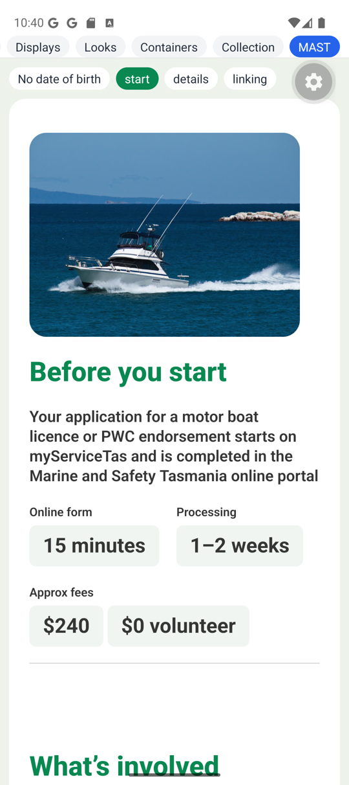
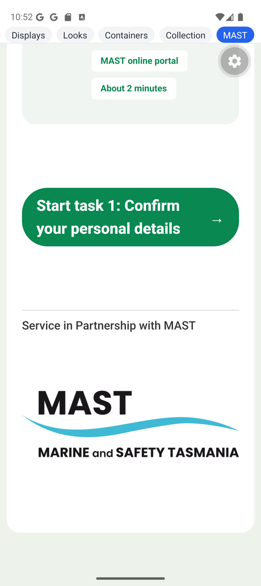
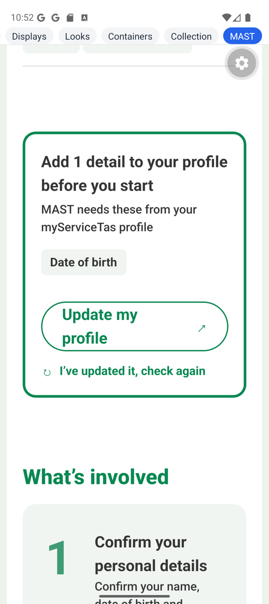
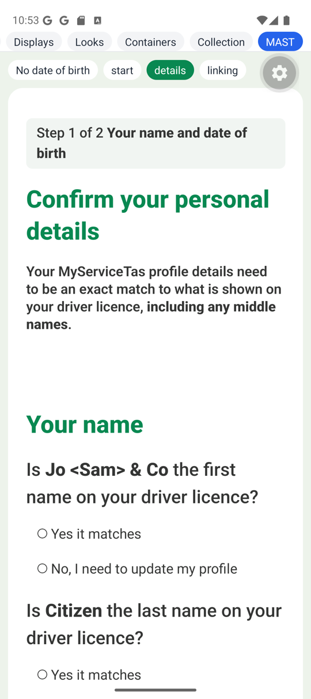
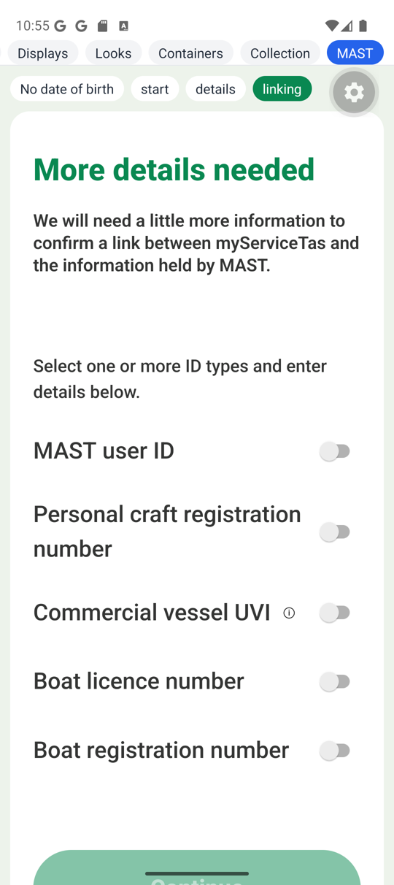
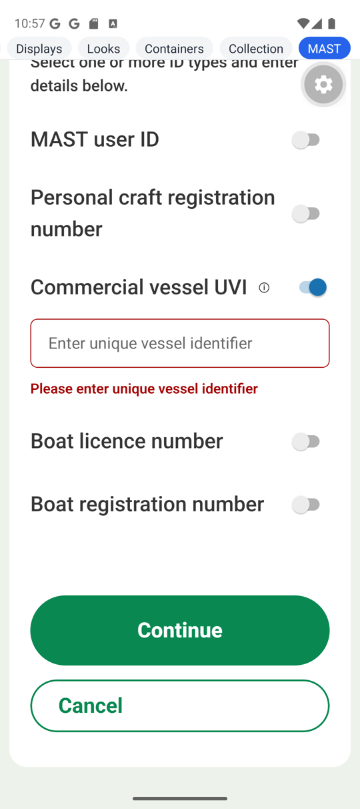

# Forms v2 — the ServiceTas MAST EOI trial, `0.1.0-alpha.6`

The rerun of the ServiceTas **MAST licence EOI wizard** against
`@rx-controls/forms-*@0.1.0-alpha.6`, from the brief
[`FORMS-V2-SERVICETAS-MAST-EOI-ALPHA6-TRIAL-BRIEF.md`](./FORMS-V2-SERVICETAS-MAST-EOI-ALPHA6-TRIAL-BRIEF.md).
It starts from the alpha.5 run's branch and worklist
([`FORMS-V2-SERVICETAS-MAST-EOI-0.1.0-alpha.5.md`](./FORMS-V2-SERVICETAS-MAST-EOI-0.1.0-alpha.5.md),
gaps N1–N11). New gaps are numbered P1 onwards.

ServiceTas branch `trial/codefirst-mast-eoi-alpha6` (throwaway, not pushed), from `e3d4e0b2`:
- `e53081b9`: the version bump.
- `e3ba79cf`: the worklist.
- `b82a5699`: two layout fixes the web parity pass found.

ServiceTas paths are relative to `ServiceTasAPI/NewClientApp/client-common`. rxc lines are cited
at the `@rx-controls/forms-react_v0.1.0-alpha.6` tag (`df5625b`).

**Verdict.**
- **The exit holds, with two forms-native fixes.** Three MAST pages ran on the Android emulator
  from their unchanged source:
  - the start page ("Before you start");
  - page 2 ("Confirm your personal details");
  - page 3 ("More details needed").

  Seven files were copied byte for byte; the only file beside them is `platform.native.tsx`.
  Two forms-native bugs stood in the way, fixed on `main` in `21b24ae` (P3, P4):
  - an image given only a width drew at its natural size;
  - a switch had no accessible name on Android.

  With those fixes the source is unchanged on native, and the pages draw and work.
- **`looks` is gone.** Every text, group, action and image look is a role the theme resolves:
  14 names, plus the built-in `primary` and `secondary`.
- **`platform.tsx` is icons and image sources only** (68 → 32 lines). `Strong` became
  `RichText`, `Picture` became `ImageDisplay`.
- **What the alpha.5 report called the only obstacle wasn't the only one.** Five more came up:
  - React Native's flex items don't shrink by default (P7);
  - an action's icon can't take its button's text colour (P5);
  - native has no per-widget shell slot (P6);
  - a `heading="group"` claims the nearest group, which pushed the page header onto a CSS grid
    native can't draw (P1);
  - the pages imported their data layer, so they couldn't be copied until it was split (P8).

  Of these, P7 needed three `shrink` classes, one of them in `components.tsx` (a no-op on the
  web), and P8 needed an app-side split. P1, P5 and P6 the form source routed around. None needed
  the form source to know the platform.
- **One behaviour is wrong on both platforms:** a refused check doesn't focus its field when the
  action holds the form's global lock (P2). On the web this shows only behind a disclosure; on
  native it shows always. Fixed on `main` since, in `f56e908`.

## 1. The page on React Native

### What ran

The start page was the obvious pick (a card, an image, an action), but it has no rich text: the
JSON version has none on that page. Page 2 has the rich text (the three "Is **name** …?" labels
and the intro) but no image. Page 3 is the only one with a required field behind a refused
`check()` and a `labelEnd` help button, which the device checks need. So all three run, in one
`Wizard` (`navigation="none"`), over one copy of the component layer.

The screen was a "MAST" entry in `apps/native-dev`, local to the run; it now lives in ServiceTas
as `components/mast/eoi-v2/EoiTrialScreen.native.tsx` (`c1db6634`, see the end). The
data layer is a fake: plain controls holding a profile, and actions that answer as MAST might,
without calling it. Auto-linking fails, so "Link my account" leads to page 3. The first name is
`Jo <Sam> & Co`, to check the `html` template.

### The files copied, and the diff

Copied into `apps/native-dev/src/mast/servicetas/` (gitignored), keeping client-common's tree so
every relative import resolves unchanged:

| file | sha256 (first 16) |
|---|---|
| `components/mast/eoi-v2/steps/StartStep.tsx` | `ce5953d5306bf9a6` |
| `components/mast/eoi-v2/steps/DetailsStep.tsx` | `12d5ce7f41894b0e` |
| `components/mast/eoi-v2/steps/LinkingDetailsStep.tsx` | `edfefb589dde635a` |
| `components/mast/eoi-v2/eoiModel.ts` | `682f9bd760e6b6f4` |
| `forms-v2/components.tsx` | `241446702a7e248f` |
| `forms-v2/platform.tsx` | `8fd3505e15b89e27` |
| `custom-display/HowToFindLicenceNumber.tsx` | `439ff283a1064a7e` |

The checksums of each original and its copy match, and `diff -q` reports every pair the same.
That holds after the last ServiceTas commit (`b82a5699`).

**How the copies were checked:** a script did the copying and checksumming, and re-ran after
every ServiceTas change.
- `components.tsx` changed twice during the run, both times in ServiceTas first and then
  re-copied: the `TaskCard` shrink (P7), then the web grid fix.
- One experiment edited a copy in place: removing `disableType="global"` for P2. The script
  restored it at once.

**Why `HowToFindLicenceNumber.tsx` is copied:** `platform.tsx` imports the licence diagram's
data URI from it. Metro never bundles `platform.tsx`, but `tsc` resolves `./platform` to it.

### What `platform.native.tsx` holds

Metro picks it over `platform.tsx` by itself. It holds:
- **Icons as glyphs**, since the app has no icon font and `@expo/vector-icons` isn't a
  dependency of `native-dev`:
  - `next`, `external` and `refresh` are `Text` glyphs, each coloured for the button it sits in
    (white on primary, green on secondary and link) (P5);
  - `warning`, `info`, `failed` and `bullet` are plain strings, which forms-native draws in the
    display's own style and tone.
- **Images as sources:**
  - `boat` and `mastLogo` are `require`d assets;
  - the logo is the web's SVG rasterised to PNG, since React Native's `Image` draws no SVG;
  - `licenceCardBack` is the same data URI the web uses, imported from the copied
    `HowToFindLicenceNumber.tsx`.

Both maps are typed `satisfies Record<keyof typeof webIcons, unknown>` (and the same for
`images`), so a name missing on one platform is a type error.

### The native theme's roles against the html theme's

`forms-v2/serviceTasTheme.native.ts` (ServiceTas, `c1db6634`) is a `PartialNativeTheme` with the
same 14 names.
Colours are given by value (`#098851`, `#343534`), because `native-dev`'s Tailwind config doesn't
carry ServiceTas's palette; an app with it would write `text-primary` as the web does.

**Carried over as the same classes:**
- `illustration`: `rounded-[20px]`.
- `taskCard`, `notice`, `actionRequired`: background, radius, padding and border.
- `stats`, `footer`: their rules, without html's `border-0 border-solid` resets.
- `tag`, `statValue`, `progress`: background, radius, padding and type.
- `taskNumber`: size, weight, colour and `text-center`.
- `richText.strong`: `font-extrabold`.
- `inlineLink`: `underline`.

**Needed different classes:**

| what | html | native | why |
|---|---|---|---|
| line height | `leading-[1.5]` | `leading-[27px]` | React Native has no relative line height |
| shrink-to-content | `w-fit` | `self-start` | no `fit-content` width |
| a box on text | — | `overflow-hidden` | a `Text`'s radius clips only with it, on iOS |
| `missingDetail`'s centred line | `flex items-center h-[40px]` | `h-[40px] leading-[40px]` | a `Text` isn't a flex box |
| `pageTitle`'s size against the heading level | `!font-extrabold !text-[40px] …` | plain classes | native merges with tailwind-merge, so no `!` |
| `pageTitle` on a phone | `max-lg:!text-[32px]` | `text-[32px]` | only a phone draws it |
| a card's phone padding | `max-lg:p-[24px]` | `p-[24px]` | only a phone draws it |
| the image base | `max-w-full` | `max-w-full` | same class, but the native theme's base slot was empty |
| action text, label row, label | — | `shrink` | P7 |

**What NativeWind couldn't draw:**
- **`Page`'s CSS grid** (`grid`, `lg:grid-cols-…`, `lg:col-start-2`, `lg:row-span-3`). It makes
  no difference on a phone: the grid is one column there, native lays the children out as a flex
  column, and the image comes first because it is first in source order (P1).
- **A per-variant disabled look.** html's primary greys out (`disabled:bg-[#d7d7d7]`); native's
  `action.disabled` is one slot for every variant, so here it is `opacity-50`.
- **Focus rings and hover**, which have no meaning on a touch device.

**Roles native has no slot for:** none of the 14. What native lacks is html's `shellFor` (P6),
which isn't a role but a per-widget shell. It cost the grey card behind each yes/no question and
the switches' bold 18px label.

### Device screenshots

Pixel_9 emulator (Android 15), Expo Go 57, React 19.2.8, one engine copy.

| | |
|---|---|
|  | **Start page.** The image first, as the JSON version's phone layout has it; then `pageTitle`, `lead`, `statLabel` / `statValue` and the `stats` rule. |
|  | **`taskCard`, `taskNumber`, `tag`**, after the `shrink` fix (P7). Before it, the text column ran off the right edge. "About half a day" measures a line taller than its text, an Android text-measurement quirk. |
|  | **`footer`, and the logo at `width={402}` alone**, keeping its 3.27 : 1 proportion, after the P3 fix. Before it, the logo drew at 804 × 246dp, wider than the screen. |
|  | **"No date of birth" on:** `actionRequired`, `missingDetail`, a secondary action with its ↗, and the `link` variant (not underlined). |
|  | **Page 2:** `progress` above `pageTitle`; the bold in the step pill, the intro and the label. `Jo <Sam> & Co` is drawn as text. No question cards (P6). |
|  | **Page 3**, reached by `goTo("linking")` after "Link my account": words, help, then the switch at the row's end (`labelPosition="before"`). |
|  | **A refused Continue:** the field marked and its error shown, but not focused (P2). |

### The accessibility tree (`uiautomator dump`)

Page 3, UVI switched on, with both forms-native fixes in place:

```
View        text='More details needed'                      (role heading)
TextView    text='MAST user ID'
Switch      desc='MAST user ID'                             checkable
Switch      desc='Personal craft registration number'      checkable
TextView    text='Commercial vessel UVI'
Button      desc='Help: Commercial vessel UVI'              clickable
Switch      desc='Commercial vessel UVI'                    checkable
EditText    desc='Commercial vessel UVI'  text='Enter unique vessel identifier'
Switch      desc='Boat licence number'                      checkable
Switch      desc='Boat registration number'                 checkable
Button      desc='Continue'                                 clickable
```

- **Each switch is named by its label,** but only with the P4 fix. Without it, all five had an
  empty description.
- **The help button is "Help: Commercial vessel UVI"** (N7).
- **The revealed input** (`hideLabel`) is named by its hidden label.

Page 2:
- each radio is named by its option ("Yes it matches");
- the question text shows as text with markup as text: `Is Jo <Sam> & Co the first name …`.

**Not settled:** whether the radio group itself is named by its question. forms-native sets
`aria-label` on the `radiogroup` view, but `uiautomator` doesn't list it. Heading levels don't
show in `uiautomator` either. Both need TalkBack.

### What was checked on the device

| check | result |
|---|---|
| The page draws | Yes, all three pages. No JS warnings on the device: logcat holds only Expo's reload noise. |
| The roles look like roles | Yes, with the differences in P6 |
| The rich text's emphasis shows | Yes: step pill, intro and labels |
| The image keeps its proportions | With P3 fixed. The boat (width and height given, `fit="cover"`) was right from the start. |
| A refused action focuses its field | **No** (P2). Without `disableType="global"`, yes: the input focused and the keyboard rose. Fixed since (`f56e908`), not yet rerun on the device. |
| The tree names each control and each help button | Yes, with P4 fixed |

## 2. Roles and the seam

### The variant names, by kind

| kind | names | where |
|---|---|---|
| text | `pageTitle`, `lead`, `progress`, `statLabel`, `statValue`, `tag`, `missingDetail`, `taskNumber` | `Page`, `StepPill`, `Stat`, `Tag`, `MissingDetail`, `TaskCard` |
| group | `notice`, `taskCard`, `actionRequired`, `stats`, `footer` | `IconNote notice`, `TaskCard`, `ActionRequired`, `Stats`, `PageFooter` |
| action | `link`, `inlineLink` (with the built-in `primary`, `secondary`) | standalone links, links inside prose |
| image | `illustration` | the boat |

**Names that only make sense as a look:**
- **`link` is the honest one.** It's the built-in, and it says how the action looks, not what it
  is (a secondary way on). It's kept because every implementation already draws it.
- **`stats` and `footer` name a place more than a role.** They still mean the same thing on any
  platform.

Every name came up once in the Ant swap's dev warnings (`?path=mast-eoi-v2-antd`, no ServiceTas
theme), each drawing Ant's base look. That list is the vocabulary another implementation's theme
has to fill in. The alpha.5 coupling is gone: Ant no longer shows ServiceTas's cards and pills.

### What is left in `platform.tsx`

- `icons`: seven Font Awesome `<i>` nodes, by meaning.
- `images`: three sources: two URLs and a data URI.

That's all. The alt text moved into the pages, where it belongs: it is what the image says, not
where it comes from.

### Base-slot conflicts the theme was shaped around

html adds a variant's classes to the base slot on the same element (`theme.tsx:363`), so two
utilities of one kind resolve by stylesheet order. Three conflicts came up:

1. **Text typography against every text variant.** `text.className` held
   `font-medium text-[18px] leading-[1.5]`; every variant sets one of those.
   - **Shaped:** the base typography moved to `displayShell.display`, the wrapper, and
     `text.className` is now `m-0`.
   - **Why it works:** the text element inherits the body look, and a variant on the element wins
     by inheritance, not stylesheet order.
   - **Not in the docs:** nothing in them suggests this. It is the single most useful thing a
     theme author would need to know.
2. **A heading level against a heading variant.** `pageTitle` lands on the same element as
   `text.heading.levels[2]` (`html.tsx:690`); the wrapper trick doesn't help, since the level's
   class is on the element.
   - **Shaped:** weight and leading moved from `heading.className` into each level, and
     `pageTitle` uses `!` for size, weight and leading. These are the theme's only `!`s outside
     the documented radio/checkbox ones.
3. **Group variants against the wrapper's base.** `contents.wrapper` is
   `flex flex-col gap-[20px]`. Every group variant only adds a box (background, border, radius,
   padding) and never touches display or gap, so nothing conflicts by construction.

Actions didn't conflict: the theme already left padding to the variants (alpha.5), and
`inlineLink`'s `inline` replaces nothing on the base.

Native had none of this: tailwind-merge resolves a variant over the base, whatever the order.

## 3. The worklist

| alpha.5 workaround | alpha.6 replacement | result |
|---|---|---|
| N1 `looks` text classes | `TextDisplay variant` from `text.variants` | **Closed, fits.** Eight roles. Fits once the base typography moves to the wrapper (§2). |
| N2 `looks` group classes | `variant` on `Contents` / `Section`, from `contents.variants` | **Closed, fits.** Five roles on the wrapper. The pills and tags became text variants, so `displayShell` needed no variants. |
| N3 page title as the `Section`'s title | `TextDisplay heading="group"` | **Closed, awkwardly.** The step pill sits above the title and the image above it on a phone, matching the JSON version. But the claim goes to the *nearest* group, so the header items had to be the page's own children on a grid (P1). Outline checked: the h1, page titles at 2, groups at 3, task-card titles at 4. Unchanged under Ant. |
| N4 `useValidation().check()` then writing `page` | `useWizard().check()`, then `goTo(key)` | **Closed, fits.** The data layer no longer writes the step: every server-decided move returns an `EoiPage` key, and the page's action goes there. `goTo` writes the bound index, so the host still sees it. |
| N5 `else page.focusInvalid()` ×3 | a refused `check()` focuses | **Closed, with P2.** All three `focusInvalid` calls are gone. A refused check focuses on page 3 on the web, but not behind a closed disclosure, and never on native, because `disableType="global"` disables the field first. |
| N6 `labelRow` reordering | `CheckboxField labelPosition="before"` | **Closed, fits.** The visual order (label x=173, button 372, switch 830) is the focus order (help, then switch). `shellFor.checkbox.labelRow` is gone; `horizontal` puts the switch at the end. |
| N7 every help button "Help" | "Help: ‹label›" | **Closed.** "Help: Commercial vessel UVI" in the DOM and in Android's tree. |
| N8 `Picture` | `ImageDisplay`; sources in the seam | **Closed, fits** on the web. On native, a width-only image was wrong until P3 was fixed. |
| N9 `Strong` | `RichText` + `html` | **Closed, fits.** Six places. The radio group's name, from its label via `aria-labelledby`, is "Is UBER the first name on your driver licence?", bold word included. `Jo <Sam> & Co` draws as text on the device. |
| N10 both links underlined | `link` + `inlineLink` | **Closed, fits.** Prose links (`inlineLink`) are underlined; the standalone "I've updated it, check again" (`link`) isn't. Checked by its theme classes on the web (the profile has no missing details) and visually on the device. |
| N11 `::after` chevron | `disclosure.icon` / `iconClassName` | **Closed, fits.** The icon turns under `data-open`. The slot draws the icon *before* the title; the JSON version's chevron is after it, so the theme adds `order-last`. Small, but a `iconPlacement` would say it. |

**Wizard moves.** `useEoiWizard.ts` stopped *owning* the moves, but not the step.
- Moves are the pages' (`check`, call, `goTo`).
- The data layer still *watches* the bound page:
  - to load the address on landing on the address page;
  - to fetch the MAST link on landing on "ready";
  - in `linkMastAccount`'s failure branch, which reads the current page.
- The host owns the control for `scrollToTop` and the `&step` scaffolding.

So the bound `page` stays, as the host's, and the `Step` enum is gone: `eoiPages` lists the keys
and the index is an index into it.

**Sizes, before (alpha.5) → after:**

| file | before | after |
|---|---|---|
| `serviceTasTheme.tsx` | 179 | 247 |
| `ServiceTasFormProvider.tsx` | 18 | 18 |
| `components.tsx` | 345 | 325 |
| `platform.tsx` | 68 | 32 |
| `EoiWizard.tsx` + `EoiWizardV2.tsx` | 79 + 60 | 79 + 60 |
| `useEoiWizard.ts` | 437 | 365 |
| `eoiModel.ts` | — | 127 |
| `steps/*.tsx` | 825 | 852 |

- **The theme grew** by what `looks` held: 14 roles, with comments.
- **`components.tsx` shrank** by `looks`, while `Page` grew by the grid.
- **`eoiModel.ts`** is the pages' model, moved out of the data layer (P8); the data layer shrank
  by the same.
- **The steps grew** by `goTo` handling and by `RichText` lines being longer than JSX with
  `Strong`.

`looks` is gone: `grep looks components.tsx` finds nothing.

## 4. The new APIs in a real form

**Fitted:**
- **Variants.** One mechanism for text, groups, actions and images; the names read as the
  form's own vocabulary. The dev warning under Ant is the right tool, naming every role a theme
  has yet to fill.
- **`RichText` + `html`.**
  - The tagged template is the right default: the three labels are now one-line templates.
  - Escaping held for `<` and `&`.
  - The name on the web, through `aria-labelledby`, keeps the bold word.
- **`check()` / `goTo(key)`.** Exactly the shape a server-decided wizard wants. The data layer's
  functions became simpler too: they return an answer rather than writing state.
- **`labelPosition="before"`.** Words, help, switch, in focus order, on html and on native,
  with no theme reordering.

**Awkward:**
- **`heading="group"` and layout groups (P1).** A page header is naturally a group (the JSON
  version has three nested ones). The claim makes the page's title the header group's instead.
- **`disclosure.icon`** is drawn before the title; a chevron after it needs `order-last`.
- **`IconDisplay` has no `variant`.** The note icon's 24px became the theme's only
  `icon.className`, which fits this form only because it has one kind of icon display.

**Wrong:**
- **A refused check inside a global-lock action doesn't focus (P2).** Fixed since (`f56e908`).
- **forms-native's width-only image (P3) and unnamed switch (P4).**
- **The native group variant slot is `className`, html's is `wrapper`.** A theme author porting
  roles renames every group variant. A small inconsistency, but it is exactly the file the brief
  asks to carry over.

## 5. New gaps

### P1. `heading="group"` claims the nearest group, layout groups included

The display boundary takes `useGroupHeading()` (`display.tsx:311`), and every non-inline group
provides one (`group.tsx:300`). A page title inside a header group titles that group. The rest
of the page then heads at the same level as the page title: "What's involved" would be level 2
beside "Before you start".

The JSON start page has its title three groups deep (Header → Header text → Heading and text),
beside the image.

- **Done instead:** `Page` lays the image, pill, title, intro and stats out as the `Section`'s own
  children on a CSS grid, with the image first in source order so a phone (and native, which
  draws no grid) shows it first. A `1fr` first column stops the full-width parts from widening the
  image's `auto` column (`b82a5699`).
- **Suggest:** a group that is only layout (no `title`, no `variant`, no scope) passes the claim
  through to the group above. Or `heading="section"`, claiming the nearest scope group (a
  `Section`).

### P2. A refused check doesn't focus a field that the action's global lock has disabled

`disableType="global"` holds the form's lock for the action's length (`action.tsx:257`), which
disables every field. `check()` focuses after `settled()` (`validationScope.tsx:225`), inside the
action, so the field may already be disabled when focus arrives.

- **On the web it's a race.** On page 3 the focus is synchronous and wins. Behind a closed
  disclosure, the reveal hands focus on a commit later (`containers.tsx:54`). A mutation
  observer saw:
  - the disclosure open at 34ms with the field `disabled`;
  - the field re-enabled at 52ms;
  - focus left on "Verify licence".

  With the disclosure already open, the same click focused the field.
- **On native it always loses:** `afterMount` defers a frame (`commitEffect.ts:13`), and a locked
  `TextInput` isn't editable. Removing `disableType="global"` from the copied page (temporarily)
  made the refused Continue focus the input and raise the keyboard.
- **Done instead:** nothing. All three gated actions here use the global lock, which the brief's
  "every page action refused by `check()` now moves focus" assumes works.
- **Suggest:** a check's focus waits for the lock to lift. The action boundary could run focus
  after it releases its lock, or `focusInvalid` could defer while the scope is locked.

  No page here should opt out with `{ focus: false }`: each refusal has exactly one field to go to.
- **Fixed since, on `main` (`f56e908`):** the second suggestion. `focusInvalid` asks each
  enclosing `<Form>` before it focuses. While the lock is free the focus goes at once. Otherwise
  it waits for the commit that releases the lock, which is the one that re-enables the fields, and
  on native a frame after that. Disclosures and tabs are still revealed first. No change on the
  ServiceTas side.
  - A conformance case: a submit action with the global lock, the field focused and not
    `disabled`, `readonly` or `aria-disabled` when focus arrives. It failed under html and native
    before the fix.
  - Not yet checked on the device: the next rerun should see the refused Continue raise the
    keyboard with `disableType="global"` in place.

### P3. forms-native: an image given only a width draws at its natural size

React Native's `Image` puts the source's own `{ width, height }` in a base style under the
caller's (`Image.android.js`, the `nativeProps.style` array). `SizedImage` (`native.tsx:969`)
sets `width` and `aspectRatio` but no height (`native.tsx:1019`). So the natural height stands,
and Yoga derives the width from height × ratio.

The probes: `width={200}` drew 390 × 246dp for the logo (clamped to its container); width and
height together drew 200 × 61dp. The boat probe failed the same way. So does `Looks.tsx`'s boat
(`width={240}`) in the app's own screens.

- **Done instead:** fixed, `{ aspectRatio: ratio, height: "auto" }` (`21b24ae`).
  On the device the probes became 200 × 61 and 200 × 133dp, and the page's logo 342 × 123dp.
- **Suggest:** that fix, and a conformance case for a width-only bundled asset on device.

### P4. forms-native: a switch has no accessible name on Android

`checkbox.control: "switch"` spreads `fieldA11y`'s string `aria-label` onto React Native's
`Switch` (`native.tsx:441`). `Switch` doesn't map `aria-label` to `accessibilityLabel`, so all
five switches had an empty description.

- **Done instead:** fixed, `accessibilityLabel={a11y["aria-label"]}` on the `Switch` (`21b24ae`).
  `uiautomator` then names each by its label.
- **Suggest:** that fix. Also audit every native component the implementation spreads `a11y`
  onto, rather than `View` / `Pressable` / `TextInput`, which map it.

### P5. forms-native: an action's icon can't take its button's text colour

A string icon is wrapped in a bare `Text`, inside a `View` that carries `iconClassName`
(`native.tsx:1151`). React Native text inherits nothing from a `View`, so a `→` on a green
primary button draws black.

- **Done instead:** `platform.native.tsx` colours each glyph for the one kind of button it sits
  on. That ties the seam to the theme.
- **Suggest:** wrap a string icon in the variant's `textClassName` (as the text is), or give
  action variants an `iconTextClassName`.

### P6. forms-native has no per-widget shell slot

html's `shellFor` (`theme.tsx:45`) gives the radio its grey question card and the checkbox its
bold 18px label. `NativeTheme` has one `shell` for every widget.

- **Done instead:** nothing. On native, questions sit on the page and switch labels are the 24px
  field label.
- **Suggest:** `shellFor` in `NativeTheme`, keyed the same way.

### P7. React Native's flex items don't shrink unless told

On the web a flex item shrinks by default; in React Native `flexShrink` is 0. Three places
overflowed:
- the task card's text column (beside the number);
- a secondary button's text (pushing its ↗ outside the button);
- a long switch label (pushing the switch off the screen).

- **Done instead:**
  - `shrink min-w-0` on `TaskCard`'s column in `components.tsx`, a no-op on the web;
  - `shrink` on the native theme's action text, label row and label.
- **Suggest:** forms-native's default theme shrinks its own row children: action text, label
  row, label. The forms-native README should say that an author's row in `className` needs
  `shrink` on the child that should give way.

### P8. The pages imported their data layer

Every page took its type from `useEoiWizard.ts` (`type EoiWizard = ReturnType<…>`), and the
start page took `missingProfileDetails` from it too. That file imports the API clients and the
generated schemas, so a byte-identical copy couldn't type-check or bundle anywhere else.

- **Done instead:** `eoiModel.ts` holds what the pages see:
  - the page keys;
  - the UI and form-data shapes, structurally: a `Control<MastEoiRegistrationWizardForm>` is
    assignable to the subset;
  - the actions, and `missingProfileDetails`.

  `useEoiWizard` returns it, and the native screen's fake implements it.
- **Suggest:** not a library change. A line in the docs: a page imports a model, not its data
  layer.

### P9. On native, a switch's label isn't pressable

On the web, clicking a checkbox's `<label>` toggles it. On the device, tapping "Commercial
vessel UVI" did nothing; only the switch itself toggles.

- **Suggest:** the label `Text` of a checkbox or switch toggles it on press, as the web's does.

## 6. Visual parity

At 1440×1000 and 375×812, JSON (`?path=mast-eoi`) beside v2 (`?path=mast-eoi-v2`), using
`&step=N`. Web screenshots aren't attached: the browser pane can't write files, so the comparison
is recorded as text, as in alpha.5.

| page | 1440 | 375 |
|---|---|---|
| 1 Before you start | **Matches** after `b82a5699`: title, lead and stats in a 721px column (JSON: 699), stats on one row, image flush right. Before the fix the column was 511px and the stats wrapped. v2's title is 40px against the JSON's smaller one, as in alpha.5. v2 has 20px between title and lead, which the JSON sets tight. | **Matches.** Image first, then the 32px title (as the JSON), lead and stats. 20px from image to title against the JSON's 40. No horizontal scroll. |
| 2 Personal details | **Matches.** Step pill above the title (N3), bold names, intro at 701px (`b82a5699`; it ran 1080px wide before). | Pill above the title. No overflow. |
| 3 Linking details | Words, help, switch at the row's end, as the JSON does (N6) | No overflow |
| 4–9 | Unchanged from alpha.5 apart from the page title | No overflow (`scrollWidth` 375 on every page) |

**The alpha.5 differences, rechecked:**
- **The start page's image above its title on a phone (N3):** fixed.
- **The step pill above the details page's title (N3):** fixed.
- **The standalone link not underlined (N10):** fixed (the `link` variant); prose links stay
  underlined.
- **The UVI row's order (N6):** fixed, and focus order now matches it.

**Console.** In both web versions alike: ServiceTas's "Cannot update `PageContent` while rendering
`Reactive`", one "Cannot update … `RenderElements` / `PageHeader`" (the page shell), and
`console.log(undefined)`. Nothing from Forms v2 under html. Under Ant, one dev warning per
unknown variant name, as designed.

## 7. Against alpha.5

| alpha.5 suggestion | now |
|---|---|
| N1 `TextDisplay variant` | **Fixed.** |
| N2 group and display-shell variants | **Fixed** for groups; display-shell variants turned out not to be needed. |
| N3 `heading="group"` (or a group header) | **Fixed,** with P1. |
| N4 `WizardController.check()` | **Fixed.** |
| N5 focus on refusal by default | **Fixed,** with P2. |
| N6 a trailing label drawn beside, not wrapping | **Fixed** as `labelPosition`, a better shape than the suggestion. |
| N7 a help name per field | **Fixed.** |
| N8 `ImageDisplay` | **Fixed** on the web; P3 on native. |
| N9 emphasis inside text | **Fixed** as `RichText`. |
| N10 action variants | **Fixed.** |
| N11 `disclosure.icon` | **Fixed;** after-title placement needs `order-last`. |

**What alpha.5 got wrong:**
- **"The component layer would not carry to native … only because of the `looks`."** With
  `looks` gone it still didn't carry as it stood. The rest is in the verdict (P1, P5, P6, P7,
  P8), and three classes were all the form-side fixes needed.
- **"`focusInvalid()` … opened the disclosure and focused the field, which is right."** It did
  then, because the call came after `check()` had resolved, a beat later than alpha.6's built-in
  focus. That timing is why P2 shows only now.

## Compat and the engine

- **Versions:**
  - `@rx-controls/forms-react` / `forms-html` / `forms-antd` pinned to `0.1.0-alpha.6`;
  - `@react-typed-forms/core` `^5.1.5`, in all 11 declarations;
  - `@rx-controls/react` `^1.1.5`.
- **The lockfile** holds one `@rx-controls/core@1.1.4` (the latest) and one
  `@rx-controls/react@1.1.5`.
- **`transpilePackages`** is unchanged.
- **The alpha.5 source type-checked against alpha.6** before any change.
- **Type-checks and builds:** `client-common` and `sites/portal` type-check with no errors, and
  the portal builds. rxc's `apps/native-dev` type-checks (`rushx build`) with the copies in place.

## What landed in rxc

- **The P3 and P4 fixes** are committed on `main` (`21b24ae`). forms-native's suite passes,
  49 of 49.
- **The P2 fix**, after the report, on `main` (`f56e908`), with a conformance case for it.
- **The MAST screen stays out of the repo.** It imports ServiceTas's own source, which isn't the
  public repo's to carry. What was written for it moved to the ServiceTas trial branch
  (`c1db6634`), since it is the app's own native side:
  - `forms-v2/platform.native.tsx`, with its two images in `forms-v2/assets/`;
  - `forms-v2/serviceTasTheme.native.ts`, the theme above;
  - `components/mast/eoi-v2/EoiTrialScreen.native.tsx`, the screen and its fake data layer.

  `client-common`'s `tsc` now excludes `*.native.*`, having no React Native; the three files
  type-check in `apps/native-dev`, checked after the move. To run the trial again, copy the
  pages, `eoiModel.ts`, `forms-v2/` and `custom-display/HowToFindLicenceNumber.tsx` into
  `apps/native-dev/src/` keeping client-common's tree, and show `EoiTrialScreen`. Nothing is
  written in rxc.
