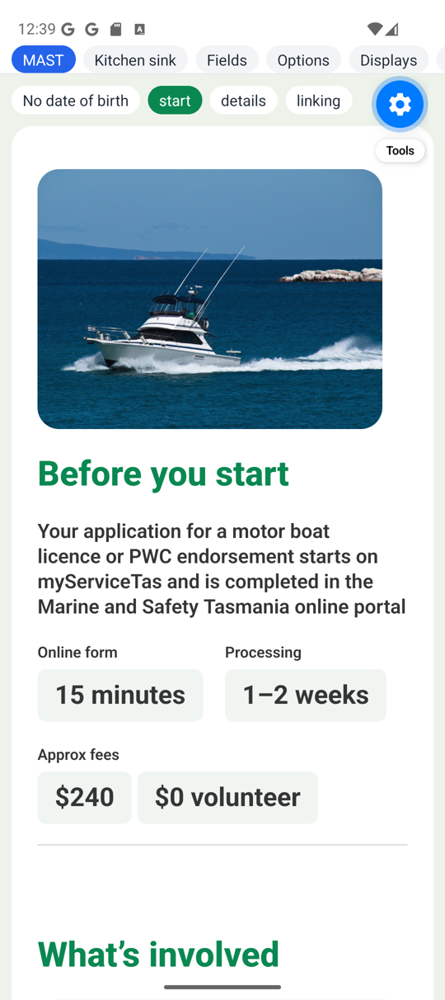
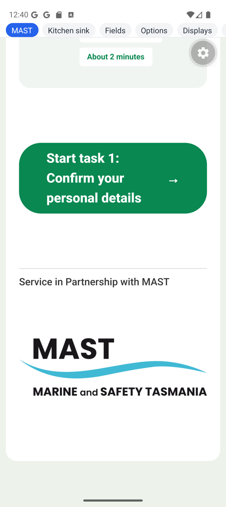
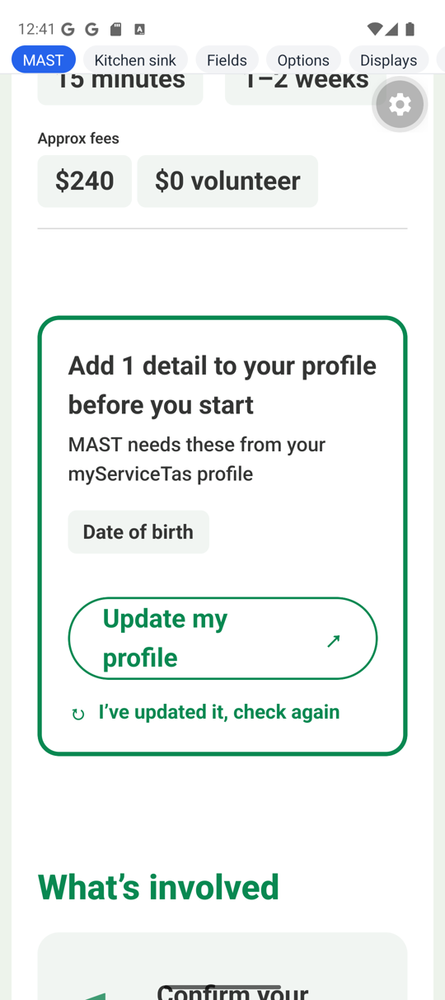
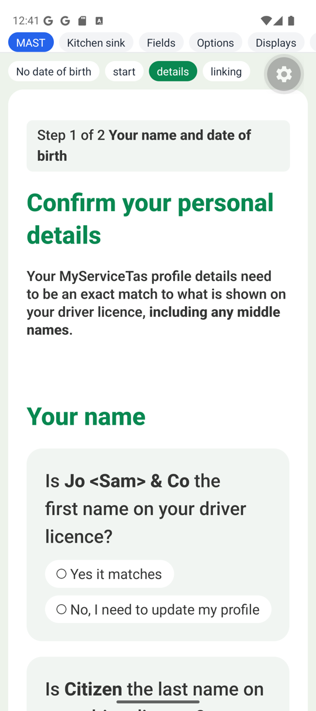
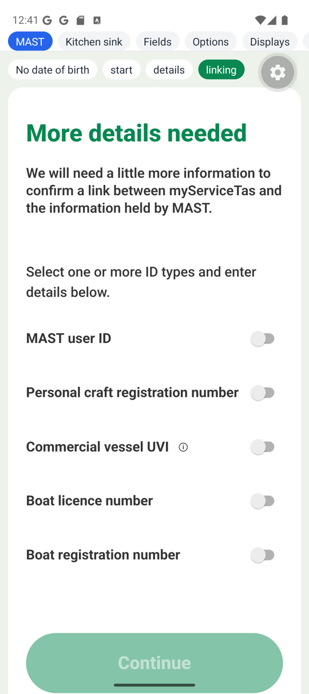
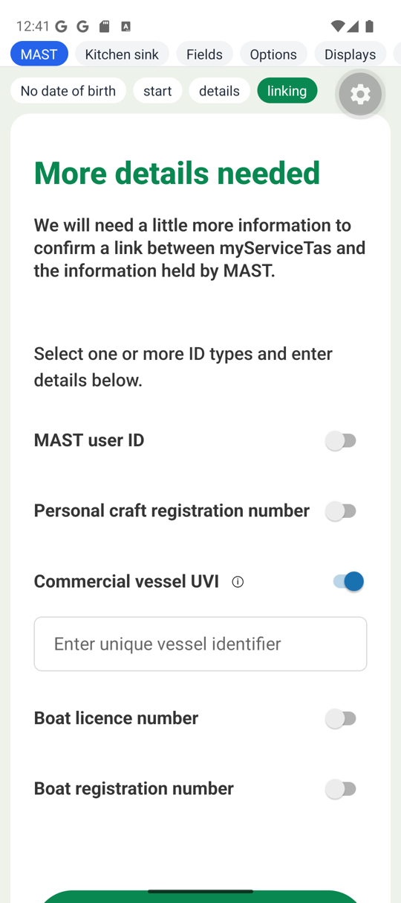
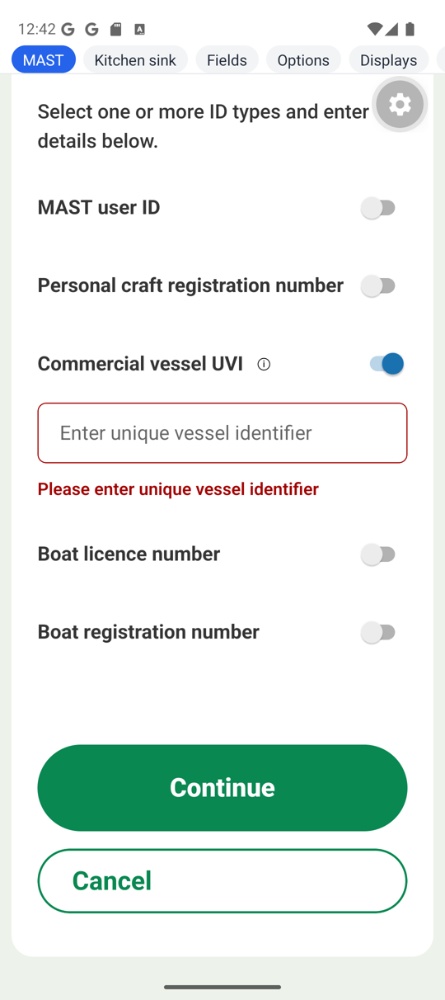
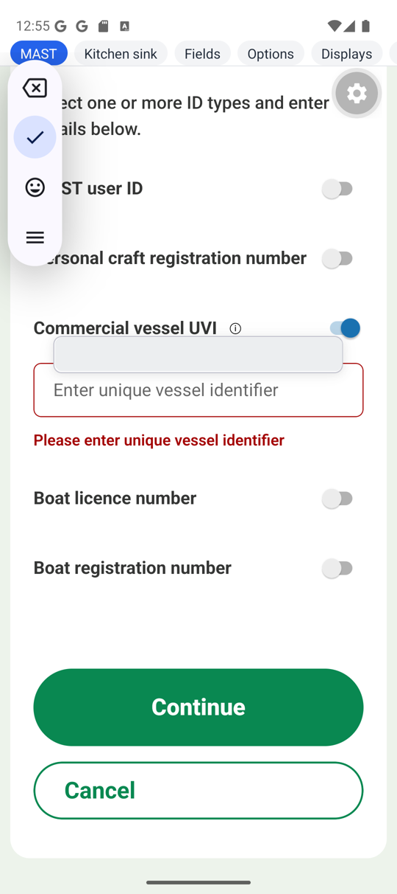

# Forms v2 — the ServiceTas MAST EOI trial, `0.1.0-alpha.7`

The rerun of the ServiceTas **MAST licence EOI wizard** against
`@rx-controls/forms-*@0.1.0-alpha.7`, from the brief
[`FORMS-V2-SERVICETAS-MAST-EOI-ALPHA7-TRIAL-BRIEF.md`](./FORMS-V2-SERVICETAS-MAST-EOI-ALPHA7-TRIAL-BRIEF.md).
It starts from the alpha.6 run's branch and gaps
([`FORMS-V2-SERVICETAS-MAST-EOI-0.1.0-alpha.6.md`](./FORMS-V2-SERVICETAS-MAST-EOI-0.1.0-alpha.6.md),
P1–P9). New gaps are numbered Q1 onwards.

ServiceTas branch `trial/codefirst-mast-eoi-alpha7` (throwaway, not pushed), from `c1db6634`:
- `66478aee`: the version bump.
- `452aa158`: the worklist.

rxc: one forms-native fix this run found, `d97e448` on `main` (not pushed).

ServiceTas paths are relative to `ServiceTasAPI/NewClientApp/client-common`. rxc lines are cited
at the `@rx-controls/forms-react_v0.1.0-alpha.7` tag (`a2f7550`).

**Verdict.**
- **Every alpha.6 workaround is gone.** On the web and in the native theme:
  - `Page` nests its header groups again, with no grid (P1);
  - the native glyphs are plain strings (P5);
  - the native theme has `shellFor` (P6) and `wrapper` for its group variants;
  - the note icon is an `IconDisplay variant`;
  - the chevron is `iconPlacement: "after"`.

  Each replacement fitted as the brief described. The start page draws the same as the grid did,
  at both widths and on the device.
- **The copied pages still run unchanged on native, with only `platform.native.tsx` beside
  them.**
  - The three pages and `eoiModel.ts` have the same checksums as in the alpha.6 run: alpha.7
    didn't touch them.
  - `components.tsx` changed (`Page`), in ServiceTas first, and the copy matches it.
  - The native pages are closer to the web's: the question cards, the switch labels and the
    button glyphs in their buttons' colours.
- **P2 didn't hold on the device as alpha.7 shipped it.** The focus did wait for the lock, as
  the fix intends, but the input never took it. The cause was a second forms-native bug (Q2):
  - once a lock lifted, a disabled state handed to React Native went from `true` to
    `undefined`, not `false`;
  - Android disables a view for `true` and enables it again only for an explicit `false`;
  - so after any `disableType="global"` action every text input on the form stayed disabled. A
    refused check couldn't focus it, and nor could a tap.

  Fixed in `d97e448`, with a test. With the fix, a refused Continue on page 3 focuses the field
  and raises the keyboard, the lock still in place.
- **One look native still can't match: the switch's colour (Q1).** The switches are Android's
  default blue, where the web's are green. `NativeTheme` has no slot for them.
- **TalkBack is not settled.** It was on, but couldn't be driven from `adb`, and two captures
  saw no TalkBack activity. Whether the radio group is announced by its question, and the
  headings as headings, carries over again.

## 1. The pages on React Native

### What ran

The same three pages as the alpha.6 run, in one `Wizard` (`navigation="none"`):
- the start page ("Before you start");
- page 2 ("Confirm your personal details");
- page 3 ("More details needed"), reached through "Link my account".

They run over the fake data layer in `EoiTrialScreen.native.tsx` (ServiceTas, from `c1db6634`).
It's shown from a "MAST" entry in `apps/native-dev`'s `App.tsx`, a local edit that stays out of
the repo, as the copies do (`apps/native-dev/src/mast/` is excluded in `.git/info/exclude`).

### The files copied, and the diff

Copied into `apps/native-dev/src/mast/servicetas/`, keeping client-common's tree:

| file | sha256 (first 16) | since alpha.6 |
|---|---|---|
| `components/mast/eoi-v2/steps/StartStep.tsx` | `ce5953d5306bf9a6` | unchanged |
| `components/mast/eoi-v2/steps/DetailsStep.tsx` | `12d5ce7f41894b0e` | unchanged |
| `components/mast/eoi-v2/steps/LinkingDetailsStep.tsx` | `edfefb589dde635a` | unchanged |
| `components/mast/eoi-v2/eoiModel.ts` | `682f9bd760e6b6f4` | unchanged |
| `components/mast/eoi-v2/EoiTrialScreen.native.tsx` | `167794403705b7be` | unchanged (in ServiceTas since `c1db6634`) |
| `forms-v2/components.tsx` | `2d4493d69f5db3bf` | `Page` (P1), `IconNote`'s variant |
| `forms-v2/platform.tsx` | `8fd3505e15b89e27` | unchanged |
| `forms-v2/platform.native.tsx` | `353c14283aa017e6` | plain glyphs (P5) |
| `forms-v2/serviceTasTheme.native.ts` | `337265c24819b335` | the alpha.7 slots |
| `forms-v2/assets/boat.jpg` | `a3e61e2d4214b0c2` | unchanged |
| `forms-v2/assets/mast-logo.png` | `0b2ceaeeced0e3b8` | unchanged |
| `custom-display/HowToFindLicenceNumber.tsx` | `439ff283a1064a7e` | unchanged |

- **Each original matches its copy:** the same checksums, and `diff -q` reports every pair the
  same, after the last ServiceTas commit (`452aa158`).
- **How the copies were checked:** a script did the copying and checksumming, as in the alpha.6
  run.
- **The one edit to a copy was an experiment:** `disableType="global"` taken off
  `LinkingDetailsStep.tsx` for Q2. The script restored it, and the final `diff` includes it.
- **How the screen is imported:** `App.tsx` names `EoiTrialScreen.native` with its suffix,
  because `tsc` doesn't resolve platform suffixes.

### What `platform.native.tsx` holds

Only icons and image sources, both maps typed
`satisfies Record<keyof typeof webIcons, unknown>` (and `webImages`):
- **Icons:** seven plain string glyphs (`→ ↗ ↻ ⚠ ⓘ ✕ •`). The `Text` import, the `glyph` helper
  and every colour are gone (41 → 27 lines).
  - A glyph on a button is drawn in the variant's text look: white on primary, green on
    secondary and link.
  - `action.iconTextClassName` (`no-underline` by default, `theme.tsx:304`) keeps the
    underline off a glyph.
- **Images:** `require`d `boat` and `mastLogo`, and the licence diagram's data URI, as before.

### The native theme against the alpha.6 one

**The rename.**
- **Type-checked first:** the alpha.6 theme against alpha.7, in `native-dev`, before any change.
  - Five errors, one per group variant: `className` isn't in `GroupVariantClasses`
    (`theme.tsx:25`).
  - With those fixed, a sixth: `contents.className`.
- **Each became `wrapper`, as html's.** The web side type-checked against alpha.7 unchanged
  before any edit. `client-common` excludes `*.native.*`, so the break shows only where React
  Native is.

**`shellFor`** (`theme.tsx:61`), keyed as html's:
- `radio.className`: the question card. Same background, radius and gap as html's
  `questionCard`. `self-start` stands in for `w-fit`, and `p-[24px]` for `p-[40px] max-lg:p-[24px]`.
- `checkbox.label`: bold 18px, with `shrink`.
- `checkbox.horizontal`: the row with the switch at its end. Moved from `shell.horizontal`, as
  html has it.

**Also new:**
- `icon.variants.note` (24px; the base is now body size);
- `disclosure.iconPlacement: "after"`.

**Carried over as the same classes, now:** besides the alpha.6 list (`illustration`, `taskCard`,
`notice`, `actionRequired`, `stats`, `footer`, `tag`, `statValue`, `progress`, `taskNumber`,
`richText.strong`, `inlineLink`):
- the question card's background, radius and gap;
- the switch label's weight, size and colour;
- the note icon's size.

The differences are the alpha.6 ones: pixel line heights, `self-start` for `w-fit`, and the
phone padding without `max-lg:`.

**Kept:** the theme's own `shrink` on `shell.label`, `shell.labelRow` and `action.textClassName`
(P7). A partial theme's slot replaces the default's string, so the default's `shrink` doesn't
reach a slot this theme fills.

**What NativeWind still can't draw:**
- **The switch's colours** (Q1).
- **A per-variant disabled look.** `action.disabled` is one slot, `opacity-50`.
- **Focus rings and hover.**
- **`lg:` layout** in `components.tsx` (`lg:flex-row-reverse` and the rest): a no-op on a phone,
  which is where the image comes first by source order.

### Device screenshots

Pixel_9 emulator (Android 15), Expo Go, React 19.2.8, one engine copy. Screenshot 8 is alpha.7 as
shipped; 9 and the rest of the run's later checks are with `d97e448`.

| | |
|---|---|
|  | **Start page, header nested (P1).** The image first, then `pageTitle`, `lead` and the stats. Drawn from groups now, not a grid's children. |
|  | **`taskCard`, `taskNumber`, `tag`.** As alpha.6. "About half a day" is no taller than its text now: alpha.6's measurement quirk is gone. |
|  | **The `→` white on primary, from a plain string (P5).** The logo at `width={402}` alone keeps its 3.27 : 1 proportion (P3's bundled-asset case). |
|  | **"No date of birth" on:** the `↗` green on secondary and the `↻` green on `link`, with no colour in the seam (P5). |
|  | **Page 2: the question cards (P6)**, from `shellFor.radio`. `Jo <Sam> & Co` drawn as text. |
|  | **Page 3: the switch labels (P6)**, bold 18px from `shellFor.checkbox`, where alpha.6 had the 24px field label. |
|  | **Tapping "Commercial vessel UVI" toggled its switch (P9)** and revealed the input. The switch is Android's blue (Q1). |
|  | **A refused Continue on alpha.7 as shipped:** marked and its error shown, not focused, no keyboard (Q2). |
|  | **The same with `d97e448`:** the input focused and the keyboard up (the IME toolbar, left; its clipboard chip blanked), `disableType="global"` still in place. |

### The accessibility tree (`uiautomator dump`)

Page 3, UVI switched on, after a refused Continue, with `d97e448`:

```
View        text='MAST user ID'
Switch      desc='MAST user ID'                             checkable clickable
View        text='Personal craft registration number'
Switch      desc='Personal craft registration number'      checkable clickable
View        text='Commercial vessel UVI'
Button      desc='Help: Commercial vessel UVI'              clickable
Switch      desc='Commercial vessel UVI'                    checkable clickable checked
EditText    desc='Commercial vessel UVI'  text='Enter unique vessel identifier'  clickable focused
TextView    text='Please enter unique vessel identifier'
View        text='Boat licence number'
Switch      desc='Boat licence number'                      checkable clickable
View        text='Boat registration number'
Switch      desc='Boat registration number'                 checkable clickable
Button      desc='Continue'                                 clickable
```

- **Without `d97e448`, the same `EditText` is `enabled="false"`** for good after the first
  Continue.
- **Page 2's radios:**
  - each is named by its option ("Yes it matches");
  - each read `enabled="false"` after any earlier global action, though they still selected on
    a tap (Q2);
  - on a fresh launch, and with the fix, `enabled="true"`.
- **The page title** and the group titles are `View`s with their text. `uiautomator` doesn't
  show heading roles or levels.

### TalkBack

**Not settled.**
- **On, but not drivable from `adb`.** TalkBack was on (its service bound, its focus box on the
  app's first tab).
  - `adb shell input tap` goes past touch exploration: the tap selected a radio directly, and
    TalkBack's focus didn't move.
  - Its keyboard shortcut (Alt+→, by `input keycombination`, with and without the keyboard
    source) didn't move it either.
- **Driven by hand, nothing was captured.** Two captures (3 and 4 minutes, a frame every
  0.3–0.4s) saw no TalkBack activity: only the status-bar clock changed.

Still open, as after alpha.6:
- whether the radio group is announced by its question;
- whether the headings are announced as headings, and at what level.

The next run should have someone swipe through on a device or emulator window, or script
TalkBack through its own test hooks.

### The device checks

| check | result |
|---|---|
| The three pages draw, no JS warnings | **Yes.** Metro and logcat (`ReactNativeJS:W`) hold no warnings or errors. Metro served alpha.7: the bundle carries `whenUnlocked` and `lg:flex-row-reverse`. |
| The question cards, the switches' labels in their own look | **Yes** (P6) |
| The button glyphs in their buttons' colours, none set in `platform.native.tsx` | **Yes** (P5) |
| A refused Continue on page 3 focuses the field and raises the keyboard, with `disableType="global"` | **No as shipped; yes with `d97e448`** (Q2). Without the lock, yes either way. |
| Tapping a switch's label toggles it | **Yes** (P9) |
| The logo at `width={402}` alone keeps its proportions | **Yes** (P3) |
| The tree names each control and each help button | **Yes**, with the radios' enabled state right only with `d97e448` |
| TalkBack: the radio group's name, the heading levels | **Not settled** |

## 2. The worklist

| alpha.6 workaround | alpha.7 replacement | result |
|---|---|---|
| P1 `Page` on a CSS grid | Nest the header groups; layout groups pass `heading="group"` on | **Closed, fits.** Header → header text → pill, title, intro, stats, beside the image (`lg:flex-row-reverse`, the image first in source). Neither inner group has a title, variant or scope, so the claim passes to the `Section` (`group.tsx:246`). The outline is unchanged, and the same under Ant. The `1fr` fix went with the grid. |
| P2 nothing | The focus waits for the lock | **Web: closed. Native: closed only with `d97e448`** (Q2). The gate itself works on the device (below). |
| P5 per-button glyph colours | Plain strings; `iconTextClassName` | **Closed, fits.** |
| P6 no cards, 24px switch labels | `shellFor` in the native theme | **Closed, fits.** Three entries, keyed as html's. |
| P7 `shrink` in the theme and `TaskCard` | The default shrinks; a replacing theme still needs it | **Changed, as documented.** All four `shrink`s stay: three because this theme replaces those slots, one because it's the author's own row. |
| P8 `eoiModel.ts` | The README says it | **Closed.** The three pages import only `forms-react`, `components`, `platform` and `eoiModel`. The README's "One form source for the web and native" (`README.md:199`) says what this trial did. |
| P9 nothing | A checkbox's label toggles it | **Closed.** Checked on the device. In the tree the label `View` is focusable but not clickable, so whether a TalkBack double-tap on it toggles is part of what TalkBack left open. |
| — `icon.className` 24px | `IconDisplay variant` | **Closed, fits.** `note` in both themes. Under Ant it warns once when an icon draws (`antd.tsx:810`), as every other role does. |
| N11 `order-last` | `disclosure.iconPlacement: "after"` | **Closed, fits.** The summary's nodes are the title text, then the chevron's span. |
| — native group variants under `className` | `wrapper` (breaking) | **Closed.** Six renames, each caught by the type. |

**P2 on the device, in detail.** Logged from inside forms-react's built output (temporary, since
removed), on a refused Continue with the global lock:
- `focusInvalid` ran inside the action (`validationScope.tsx:219`), with the lock at 1, so the
  gate queued the focus (`scope.tsx:301`).
- The input re-rendered disabled, then enabled.
- The lock lifted; the focus ran a frame later (`scope.tsx:329`), on the `TextInput`.
- `isFocused()` then read `true`, but Android had no focused view and no keyboard.

A 300ms delay in place of the frame changed nothing, so it isn't timing. The view itself was
still disabled (Q2).

**Sizes, before (alpha.6) → after:**

| file | before | after |
|---|---|---|
| `serviceTasTheme.tsx` | 247 | 253 |
| `serviceTasTheme.native.ts` | 130 | 145 |
| `ServiceTasFormProvider.tsx` | 18 | 18 |
| `components.tsx` | 325 | 312 |
| `platform.tsx` | 32 | 32 |
| `platform.native.tsx` | 41 | 27 |

- **`components.tsx` shrank** by the grid and its comment. The nested header is three
  `Contents`, about as long as the grid's classes were.
- **The html theme grew** by the icon variant (one line became six) and `iconPlacement`.
- **The native theme grew** by `shellFor` (11 lines), the icon variant and the disclosure.
- **`platform.native.tsx` shrank** by the glyph helper and its comment.

## 3. The theme against the docs

`HtmlTheme`'s description (`theme.tsx:28–60`) against `serviceTasTheme.tsx`, shaped by hand in
the alpha.6 run:

| the docs say | the theme | |
|---|---|---|
| Body typography on `displayShell.display`, `text.className` only what no variant sets | `font-medium text-[18px] leading-[1.5]` on the wrapper, `m-0` on the text | matches |
| A base colour on `displayShell.color`, not the text slot | `text-text` there | matches |
| `heading.className` only what no heading variant changes; size, weight and leading in `levels` | `m-0`; each level `font-bold text-[24px] leading-[1.5]` | matches |
| A heading variant marks those `!` | `pageTitle`: `!font-extrabold !text-[40px] max-lg:!text-[32px] !leading-[1.3]` | matches |
| A group variant that only adds a box never conflicts | the five add background, border, radius, padding | matches |
| Leave out of the action base what a variant changes | padding only on the variants | matches |
| An app's element selectors outrank a slot's class; mark it `!` (`theme.tsx:28`) | `important: "#app"` in the portal's Tailwind config. The `!` on radio and checkbox, and on the action variants' text colours | matches |

**Not covered:** the "added beside, not merged" paragraph (`theme.tsx:36`) names text, group and
action variants. Icon and image variants are added the same way, and the docs don't say so.
- **What it meant here:** the note icon's 24px couldn't stay on `icon.className` beside a
  variant that sets a size, so the size moved to the variant and the base kept `inline-flex`.
- **Suggest:** name `icon.variants` and `image.variants` in that paragraph.
- **Fixed since (`c877546`):** the paragraph names both, with a bullet on keeping sizes in the
  variants and the base to what no variant sets.

## 4. New gaps

### Q1. forms-native: a switch's colours have no slot

`checkbox.control: "switch"` draws React Native's own `Switch` (`native.tsx:478`) with no
`trackColor` or `thumbColor`. `NativeTheme.checkbox` (`theme.tsx:128`) styles only the box
(`box`, `checked`, `mark`), so Android draws the Material default: blue in Expo Go.
- **Why a class can't reach it:** the colours are props, not styles.
- **On the web** the html theme draws the switch from an `<input>` (`checked:bg-primary`), so
  it's green.
- **Done instead:** nothing. The switches are blue on the device.
- **Suggest:** `checkbox.switchColors: { trackOn, trackOff, thumbOn?, thumbOff? }` in
  `NativeTheme`, as colour values, since there's no class to give.
- **Fixed since (`c877546`):** `checkbox.switchColors: { trackOn?, trackOff?, thumbOn?,
  thumbOff? }`, each optional and the platform's own when left out; `trackOff` is also iOS's
  background while off. Checked on the emulator in `apps/native-dev`'s kitchen sink (`8161778`).

### Q2. forms-native: a field disabled and enabled again stays disabled on Android

Android's view manager calls `setEnabled(!disabled)` only when `accessibilityState` has a
`disabled` key (React Native's `BaseViewManager.java:387`). forms-native handed React Native
`true` while a form was locked, and `undefined` (no key) once it wasn't:
- **The `TextInput`:** `aria-disabled={slot.disabled || undefined}` (`native.tsx:439`).
- **Radio and check-list options:** `disabled={locked || o.disabled}` (`native.tsx:566`, `630`),
  `undefined` when the option has no `disabled` of its own.
- **The checkbox and switch:** `locked` (`native.tsx:452`, `526`, `593`), `undefined` when
  `readOnly` is.
- **The select's trigger and options** (`native.tsx:717`, `741`).

So after any `disableType="global"` action:
- every text input on the form stayed disabled;
- a refused check's focus, which P2's fix had rightly held until the lock lifted, landed on a
  disabled view;
- a tap on the input did nothing;
- the radio options still selected, but read as disabled to accessibility.

A second bug sat beside it. `readOnly={slot.readOnly}` (`native.tsx:425`) is always a boolean,
and React Native's `TextInput` takes a given `readOnly` over `editable` (`TextInput.js:928`). So
`editable={false}` never reached Android, and the stuck `setEnabled(false)` was all that
disabled a locked input.

- **Why the suites missed it:**
  - They render through react-native-web, which has no such state, so P2's conformance case
    passed under native.
  - The alpha.6 run saw the same failure and put it down to timing. That run only checked the
    case without the lock.
- **Done:** fixed on `main` (`d97e448`):
  - every `disabled` handed to React Native is a boolean;
  - the `TextInput` takes `editable` alone.

  A new test (`test/disabledViews.test.tsx`) records the props the input, the radios and the
  switch get across a lock and its release. It fails before the fix and passes after; the suite
  passes, 57 of 57. On the device: the refused Continue focuses with the keyboard up, the input
  reads `enabled="true"`, and the radios after a lock too.
- **Suggest:** a rule for forms-native, in its source: a state React Native turns into a native
  setter (`disabled`, `checked`, `selected`) is always a boolean, never `undefined`.
- **Fixed since (`c877546`):** the rule heads `native.tsx`'s accessibility section, pointing at
  the test that pins it. The fix itself (`d97e448`) ships in alpha.8.

### Q3. Device-only behaviour has no check short of a device

Q2 and alpha.6's P3 (an image's size) are both React Native behaviour that react-native-web
doesn't reproduce. Each passed the suites and failed on the device.
- **Done instead:** this run's test pins the props at the boundary, which catches Q2's class of
  bug, though not the platform's response to the props.
- **Suggest:** a short device pass before each alpha that touches forms-native, scripted the way
  this run's checks were (`uiautomator` for state and names, `dumpsys input_method` for the
  keyboard). TalkBack's speech needs a person or TalkBack's own test tooling (§1).
- **Fixed since (`c877546`, `89e5e60`):** "Before an alpha that touches `forms-native`: a device
  pass" in `FORMS-V2-PLAN.md`'s Publishing section. `apps/native-dev`'s kitchen sink gained what it
  checks against: a `disableType="global"` check and a theme's `switchColors` (`8161778`). Run for
  alpha.8 and recorded in that commit: every check passed but TalkBack, which still needs a person.
  One correction it found: Expo Go sends the app's console to Metro, not logcat, so this run's
  "logcat holds no warnings" checked an empty channel.

## 5. Visual parity

At 1440×1000 and 375×812, JSON (`?path=mast-eoi`) beside v2 (`?path=mast-eoi-v2`), using
`&step=N`, measured in the browser. Web screenshots aren't attached, as before.

| page | 1440 | 375 |
|---|---|---|
| 1 Before you start | **Matches.** See below. | **Matches.** Image first (295 × 240), then the 32px title 20px under it, lead and stats. No horizontal scroll. |
| 2 Personal details | **Matches.** The pill (361px, its content's width) above the title; the intro 701px wide without `b82a5699`'s grid. | The pill above the title. No overflow. |
| 3 Linking details | Words, help, switch at the row's end, as alpha.6 | No overflow |
| 4–9 | Unchanged from alpha.6 apart from the start page's header | No overflow: `scrollWidth` 375 on all nine pages |

**The start page at 1440:**

| | v2 | JSON |
|---|---|---|
| title column | 721px, x 173–894 | — |
| lead | 701px wide | 699px wide |
| the stats' top | 618 | 617 |
| the image | at (934, 472), 319 × 240 | the same |

- **The stats are on one row,** bottom-aligned with the image: both end at 712, from
  `lg:mt-auto` on the summary in place of the grid's `self-end`.
- **The image is flush right:** its edge is at 1253, the card's padding edge (1353 − 100).
- **The same as alpha.6's grid did** (721px column, one stats row).

**Rechecked:**
- **The header nested in place of the grid:** the same column, the stats on one row, the image
  flush right at 1440 and first at 375.
- **Page 2's intro width:** 701px with no grid.
- **The disclosure's chevron after its title,** with no `order-last`.

**Focus behind a disclosure, with the global lock.**
- **The setup:** a required field put in "How to find this" (temporary, since removed), the
  licence fields filled, and "Verify licence" pressed. Its action has `disableType="global"`.
- **What a mutation observer saw:**
  - at 0ms the disclosure open and the field `disabled`;
  - at 50ms focus on the field, now enabled, where it stayed.
- **In alpha.6** focus was left on the button.
- **Nothing reached MAST:** the check refused, and no verify request was made.

**The heading outline,** through the accessibility tree, the same at both widths:
- the shell's `h1` "MAST EOI";
- each page title at level 2;
- groups at 3 ("What's involved", "Your name");
- task-card titles at 4.

The header's two layout groups pass the claim through.

**Console.**
- **v2 under html:** only ServiceTas's known noise:
  - "Cannot update `PageContent` while rendering `Reactive`";
  - one "Cannot update … `RenderElements` / `PageHeader`";
  - `console.log(undefined)`.
- **v2 under Ant:** one dev warning per unnamed role, now `note` too.
- **The JSON version** adds "Cannot update `DefaultVisibility` while rendering
  `RenderFormNode`". That's `@react-typed-forms/schemas`, not Forms v2, and it's outside this
  trial.

## 6. Against alpha.6

| alpha.6 suggestion | now |
|---|---|
| P1 layout groups pass the claim | **Fixed,** and fits. |
| P2 focus waits for the lock | **Fixed in forms-react;** on Android it needed Q2's fix too. |
| P3 width-only image | **Fixed;** checked on the device. |
| P4 switch name | **Fixed;** unchanged. |
| P5 icon in the button's text look | **Fixed.** |
| P6 `shellFor` on native | **Fixed.** |
| P7 default shrink; README | **Fixed.** A replacing theme still carries its own, as documented. |
| P8 the model note in the docs | **Fixed.** |
| P9 pressable label | **Fixed.** |
| `IconDisplay variant` | **Fixed.** |
| `disclosure.iconPlacement` | **Fixed.** |
| native group slot `wrapper` | **Fixed** (breaking, six renames). |

**What alpha.6 got wrong:**
- **Why native never focused (P2).** The report said "`afterMount` defers a frame, and a locked
  `TextInput` isn't editable". Neither held:
  - the input was never non-editable, since `readOnly={false}` overrode `editable`;
  - waiting longer didn't help.

  The view was disabled by `aria-disabled` and never enabled again (Q2). The fix in `f56e908`
  was right, but couldn't show until the view could take focus.
- **"Fixed since, not yet rerun on the device."** It was the device rerun that found Q2: the
  conformance case passed, and couldn't have failed under react-native-web.

## Compat and the engine

- **Versions:**
  - `@rx-controls/forms-react` / `forms-html` / `forms-antd` pinned to `0.1.0-alpha.7`, in
    `client-common` and `sites/portal`;
  - `@react-typed-forms/core` `^5.1.5` and `@rx-controls/react` `^1.1.5`, unchanged.
- **The lockfile** holds one `@rx-controls/core@1.1.4` and one `@rx-controls/react@1.1.5`.
- **`transpilePackages`** is unchanged.
- **The alpha.6 source type-checked against alpha.7** before any change, on the web side. The
  native theme broke as expected (§1).
- **Type-checks and builds:**
  - `client-common` and `sites/portal` type-check with no errors, and the portal builds;
  - rxc's `apps/native-dev` type-checks (`rushx build`) with the copies in place.

## What landed

- **rxc `main`, `d97e448`** (not pushed): Q2's fix in `packages/forms-native/src/native.tsx`, and
  `packages/forms-native/test/disabledViews.test.tsx`. forms-native's suite passes, 57 of 57.
- **ServiceTas `trial/codefirst-mast-eoi-alpha7`** (not pushed): the bump (`66478aee`) and the
  worklist (`452aa158`).
- **Not in either repo:**
  - the copies in `apps/native-dev/src/mast/` (excluded);
  - the "MAST" entry in `App.tsx`, reverted after the run.
