# Forms v2 — the ServiceTas MAST EOI trial, `0.1.0-alpha.8`

The rerun of the ServiceTas **MAST licence EOI wizard** against
`@rx-controls/forms-*@0.1.0-alpha.8`, from the brief
[`FORMS-V2-SERVICETAS-MAST-EOI-ALPHA8-TRIAL-BRIEF.md`](./FORMS-V2-SERVICETAS-MAST-EOI-ALPHA8-TRIAL-BRIEF.md).
It starts from the alpha.7 run's branch and gaps
([`FORMS-V2-SERVICETAS-MAST-EOI-0.1.0-alpha.7.md`](./FORMS-V2-SERVICETAS-MAST-EOI-0.1.0-alpha.7.md),
Q1–Q3). New gaps are numbered R1 onwards.

ServiceTas branch `trial/codefirst-mast-eoi-alpha8` (throwaway, not pushed), from `452aa158`:
- `859d0aa1`: the version bump.
- `3833dd26`: the native switches' colours (Q1).

rxc: nothing changed. The copies and the "MAST" entry are local, as before.

ServiceTas paths are relative to `ServiceTasAPI/NewClientApp/client-common`. rxc lines are cited
at the `@rx-controls/forms-react_v0.1.0-alpha.8` tag (`d141936`).

**Verdict.**
- **alpha.8 drops in unchanged.** The alpha.7 source type-checks against alpha.8 before any
  edit, on the web (`client-common`, `sites/portal`) and on native (`apps/native-dev` with the
  alpha.7 copies). The published web packages' runtime is byte-identical to alpha.7's:
  `forms-react` and `forms-antd` differ only in `package.json`, and `forms-html` only in
  `theme.tsx`'s doc comment (and its `.d.ts` and maps).
- **The switches are green (Q1).** One `checkbox.switchColors` entry in the native theme. Sampled
  from the device: the track `#098851` on and `#d7d7d7` off, exactly the theme's values. The thumb
  reads `#fafafa` for the theme's `#ffffff`: Android draws the thumb at about 98% of the colour
  given (a `#ff0000` test came out `#fa0000`), so this is the platform, not the slot.
- **The device pass held with no local patch (Q2).** On alpha.8 as built from the release commit,
  after two `disableType="global"` actions:
  - a refused Continue on page 3 focuses the input and raises the keyboard (`focused`,
    `mInputShown=true`), the lock still in place;
  - the input and page 2's radios are `enabled="true"`, and typing lands;
  - Metro's log holds nothing after the bundle.
- **TalkBack, settled by hand (the user, with captions on):**
  - **A radio group's question is never spoken (R1).** From "Your name. Heading", the next stop
    is "checked. Yes it matches. Radio button". The question is not a stop, and no option carries
    it. A TalkBack user hears "Yes it matches" with no idea what it answers.
  - **Headings are announced as headings, with no level** ("Confirm your personal details.
    Heading"). Android has no heading level to give.
  - **The help button:** "collapsed. Help: Commercial vessel UVI. Button", then "expanded".
  - **A switch:** "OFF. Commercial vessel UVI. Switch. A Unique Vessel Identifier is issued by
    AMSA." A double-tap toggles it.
  - **A double-tap on a switch's label does nothing:** the label never takes TalkBack's focus.
    That's by design (the switch carries the name), and P9's open half closes as "no, and it
    needn't" (§3).

## 1. The pages on React Native

### What ran

The same three pages as the alpha.7 run, in one `Wizard` (`navigation="none"`): the start page,
page 2 ("Confirm your personal details") and page 3 ("More details needed"), reached through
"Link my account". They run over `EoiTrialScreen.native.tsx`'s fake data layer, shown from a local
"MAST" entry in `apps/native-dev`'s `App.tsx`.

- **The workspace packages are alpha.8.** rxc's `main` was at `1e29c31`: the release commit
  `d141936` plus this brief, docs only. `rush build` had nothing to do.
- **The bundle carries alpha.8:** Metro's Android bundle holds `switchColors` (seven times) and
  the theme's `trackOn: "#098851"`.
- **Metro on 8081**, its output to a file. Nothing else was on the port.

### The files copied, and the diff

Copied into `apps/native-dev/src/mast/servicetas/` by a script, keeping client-common's tree:

| file | sha256 (first 16) | since alpha.7 |
|---|---|---|
| `components/mast/eoi-v2/steps/StartStep.tsx` | `ce5953d5306bf9a6` | unchanged |
| `components/mast/eoi-v2/steps/DetailsStep.tsx` | `12d5ce7f41894b0e` | unchanged |
| `components/mast/eoi-v2/steps/LinkingDetailsStep.tsx` | `edfefb589dde635a` | unchanged |
| `components/mast/eoi-v2/eoiModel.ts` | `682f9bd760e6b6f4` | unchanged |
| `components/mast/eoi-v2/EoiTrialScreen.native.tsx` | `167794403705b7be` | unchanged |
| `forms-v2/components.tsx` | `2d4493d69f5db3bf` | unchanged |
| `forms-v2/platform.tsx` | `8fd3505e15b89e27` | unchanged |
| `forms-v2/platform.native.tsx` | `353c14283aa017e6` | unchanged |
| `forms-v2/serviceTasTheme.native.ts` | `2f0f8e082c02c1e5` | **`switchColors`** (was `337265c24819b335`) |
| `forms-v2/assets/boat.jpg` | `a3e61e2d4214b0c2` | unchanged |
| `forms-v2/assets/mast-logo.png` | `0b2ceaeeced0e3b8` | unchanged |
| `custom-display/HowToFindLicenceNumber.tsx` | `439ff283a1064a7e` | unchanged |

- **Only the native theme moved,** as the brief expected. Before the copy, the alpha.7 copies
  matched alpha.7's checksums.
- **Each original matches its copy** after `3833dd26`: the same checksums, and `cmp` reports
  every pair the same.
- **The one edit to a copy was an experiment:** `thumbOn: "#ff0000"`, to see whether the thumb
  colour reaches Android. The script restored it before the final check.

### The native theme's `switchColors`

```ts
// Checkboxes are on/off settings here, as the web's switches, in their
// colours: primary when on, the html theme's grey when off, a white thumb
checkbox: {
  control: "switch",
  switchColors: {
    trackOn: "#098851",
    trackOff: "#d7d7d7",
    thumbOn: "#ffffff",
    thumbOff: "#ffffff",
  },
},
```

Where each value came from, in the html theme's `checkbox.input` (`serviceTasTheme.tsx`):

| slot | html theme class | value from |
|---|---|---|
| `trackOn` | `checked:bg-primary` | `tailwindColours.ts`: `primary.DEFAULT` `#098851` |
| `trackOff` | `bg-[#d7d7d7]` | the class itself |
| `thumbOn`, `thumbOff` | `before:bg-white` | Tailwind's white |

The slot (`theme.tsx:134`) fits as described: four optional colour values, handed to `Switch`'s
`trackColor`, `thumbColor` and `ios_backgroundColor` (`native.tsx:497–501`). The theme went from
145 lines to 154.

### Device screenshots

Pixel_9 emulator (Android 15), Expo Go, React 19.2.8, one engine copy, alpha.8 as built from
the release commit, no local patch.

| | |
|---|---|
| 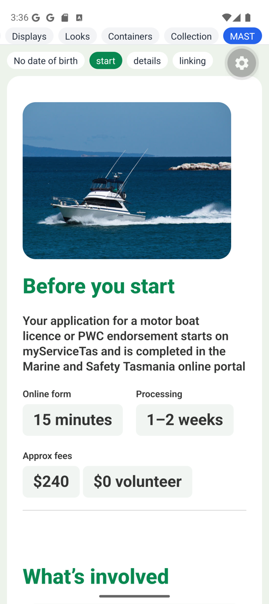 | **Start page.** As alpha.7: the image first, then the title, lead and stats. |
| 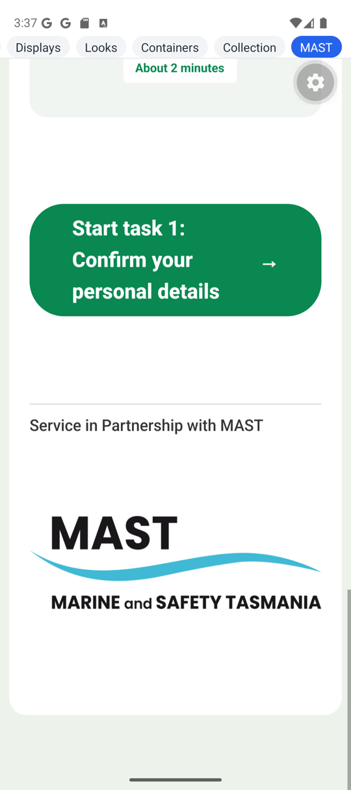 | **The logo at `width={402}` alone.** Drawn 889 × 275 px, 3.23 : 1, against the PNG's 3.27 (the light blue of the wave falls under the measuring threshold). Its box is narrowed by `max-w-full` and the picture fits inside it. |
| 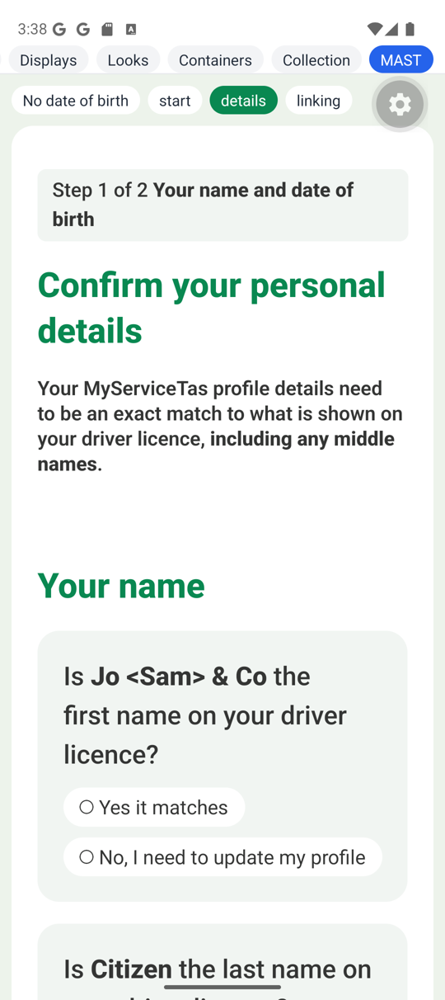 | **Page 2's question cards**, unchanged. |
| 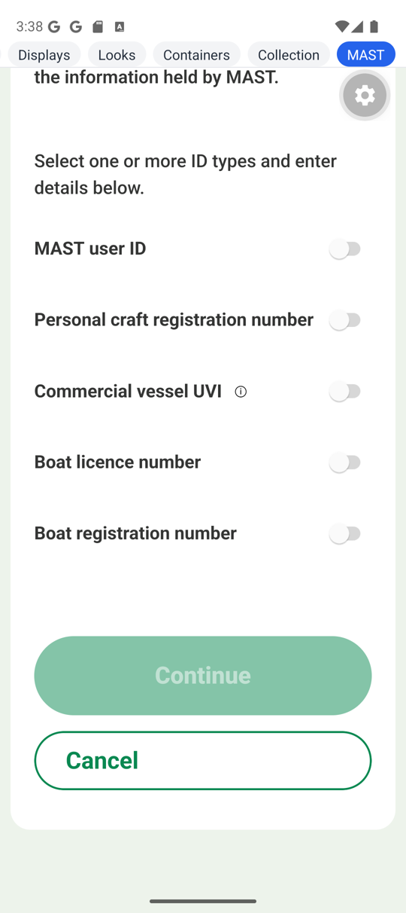 | **Page 3, the switches off:** a `#d7d7d7` track and a white thumb, after "Link my account" (a global action). |
| 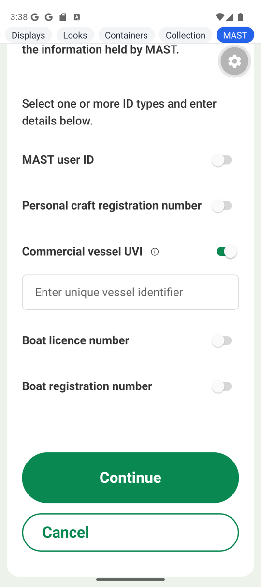 | **Tapping "Commercial vessel UVI" toggled its switch:** a `#098851` track, like the web's. |
| 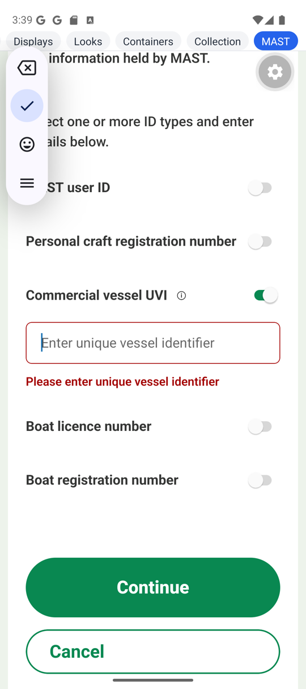 | **A refused Continue:** the input marked, focused, the keyboard up (the IME toolbar, left), `disableType="global"` in place. |
| 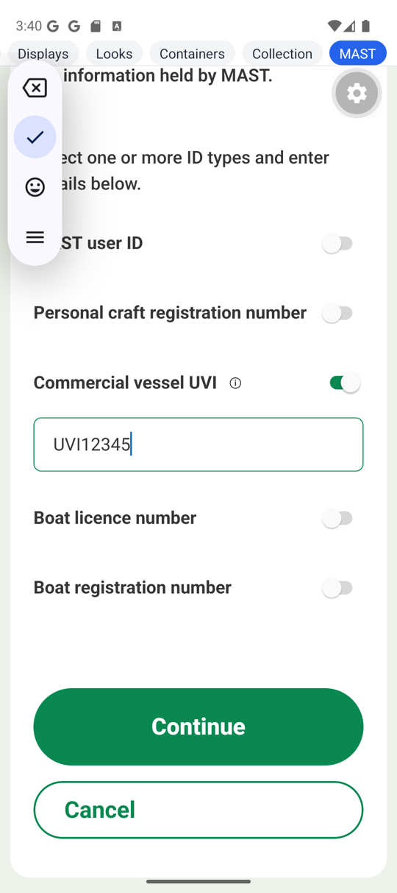 | **Typing lands** (`adb shell input text`), and the error clears. |

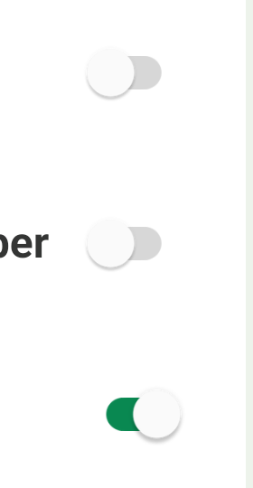

The track colours, sampled from screenshot 5 (the most common non-white colour in each switch's
box): `#d7d7d7` off, `#098851` on.

### The accessibility tree (`uiautomator dump`)

Page 3 after "Link my account" and a refused Continue, UVI switched on:

```
View        text='MAST user ID'
Switch      desc='MAST user ID'                             checkable clickable
View        text='Personal craft registration number'
Switch      desc='Personal craft registration number'      checkable clickable
View        text='Commercial vessel UVI'
Button      desc='Help: Commercial vessel UVI'              clickable
Switch      desc='Commercial vessel UVI'                    checkable clickable checked
EditText    desc='Commercial vessel UVI'  text='Enter unique vessel identifier'  clickable focused
TextView    text='Please enter unique vessel identifier'
View        text='Boat licence number'
Switch      desc='Boat licence number'                      checkable clickable
View        text='Boat registration number'
Switch      desc='Boat registration number'                 checkable clickable
Button      desc='Continue'                                 clickable
```

Every node `enabled="true"`. `dumpsys input_method`: `mInputShown=true`, the served view the
`ReactEditText`.

Page 2's radios after both global actions: all six `enabled="true"`.

Page 2's first question in the raw dump (R1):

```
TextView     text='Is Citizen the last name on your driver licence?'   focusable=false
RadioButton  desc='Yes it matches'                    focusable=true
  TextView   text='Yes it matches'
RadioButton  desc='No, I need to update my profile'   focusable=true
  TextView   text='No, I need to update my profile'
```

No node carries the question as its name. The question's `TextView` and the options are siblings.

### The device pass

From rxc's `FORMS-V2-PLAN.md`, "Before an alpha that touches `forms-native`: a device pass":

| check | result |
|---|---|
| The three pages draw, nothing in Metro's log after the bundle | **Yes.** After `Android Bundled`, the log holds nothing: not on the device's load, a fast refresh, or the walk. |
| A refused Continue on page 3 focuses the field and raises the keyboard, `disableType="global"` in place | **Yes**, with alpha.8 as published (no local patch): `focused="true"`, `mInputShown=true` |
| After any global action, every field enabled | **Yes.** The page 3 input, after "Link my account" and a refused Continue; page 2's six radios after both. Typing lands. |
| The switches green | **Yes.** Tracks exact; the thumb at Android's 98% (above) |
| The logo at `width={402}` alone keeps its proportions | **Yes**, 3.23 : 1 drawn |
| Tapping a switch's label toggles it | **Yes** (P9, by touch) |
| TalkBack | **Settled by hand** (§2), with one new gap (R1) |

## 2. TalkBack

**How it was run.** TalkBack 15.0 on the emulator, with "Display speech output" on (TalkBack
settings → Advanced settings → Developer settings), so each utterance shows as a caption.
- **The user drove it.** A mouse drag in the emulator window is too slow to count as a swipe:
  TalkBack takes it as a finger exploring. So they used a click to explore (TalkBack focuses and
  reads what's under the pointer), Alt + → / ← to move, and a double-click or Alt + Enter to
  activate.
- **A script saved a frame** whenever the bottom of the screen changed: about 260 frames, read as
  contact sheets.
- **TalkBack's own log doesn't help.** Its "Log output level" set to VERBOSE resets to ERROR
  when the service starts, so its speech isn't in logcat.
- **Afterwards:** TalkBack off, "Display speech output" off, the log level back to ERROR.

**What it said:**

| item | TalkBack said | |
|---|---|---|
| Page 2's step pill | "Step 1 of 2 Your name and date of birth" | |
| The page title | "Confirm your personal details. Heading" | a heading, no level |
| A group title | "Your name. Heading", "Your date of birth. Heading", "Marine and Safety Tasmania online portal. Heading" | headings, no level |
| The intro | "Your MyServiceTas profile details need to be an exact match …, including any middle names." | |
| **Each radio group** | **Nothing.** After "Your name. Heading" comes "checked. Yes it matches. Radio button", then "not checked. No, I need to update my profile. Radio button", then the next question's options. Likewise "Do you have a MAST online portal account?": only "checked. Yes. Radio button", "not checked. No. Radio button" | **R1** |
| Page 3's help button | "collapsed. Help: Commercial vessel UVI. Button"; pressed, "expanded", then "collapsed" | as intended |
| A switch | "OFF. Commercial vessel UVI. Switch. A Unique Vessel Identifier is issued by AMSA." | name, state, role and the help text as its hint |
| A double-tap on the switch | "ON", then "OFF" | toggles |
| A switch's label ("Boat licence number") | **No focus.** A click on the words puts TalkBack's box nowhere, and a double-tap does nothing | by design (§3) |

| | | |
|---|---|---|
| 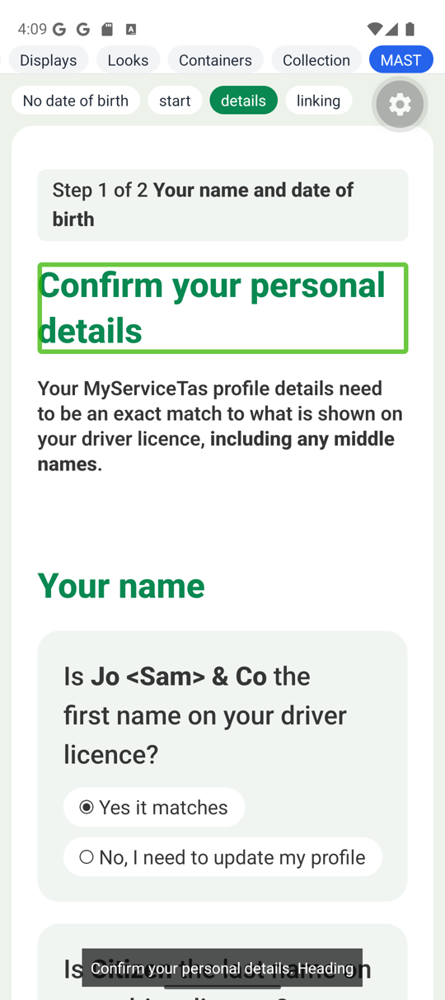 | 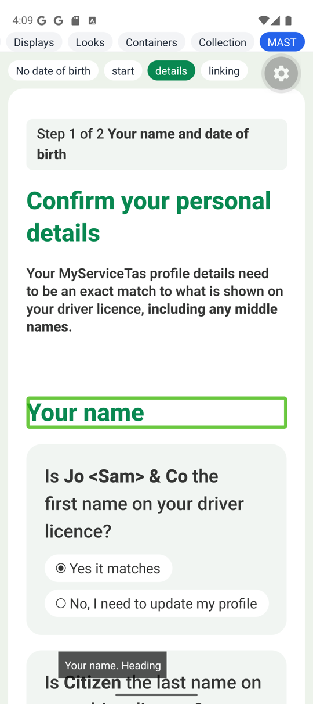 | 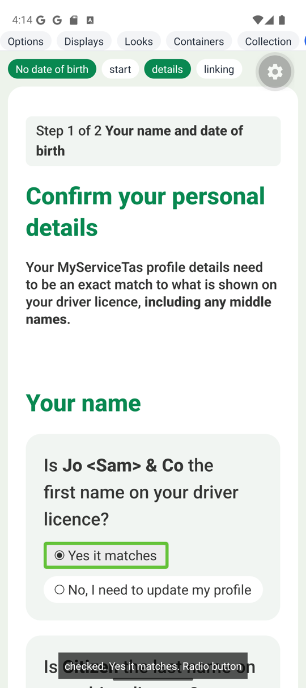 |
| **"Confirm your personal details. Heading"** | **"Your name. Heading"** | **The next stop: "checked. Yes it matches. Radio button"**, the question skipped (R1) |
| 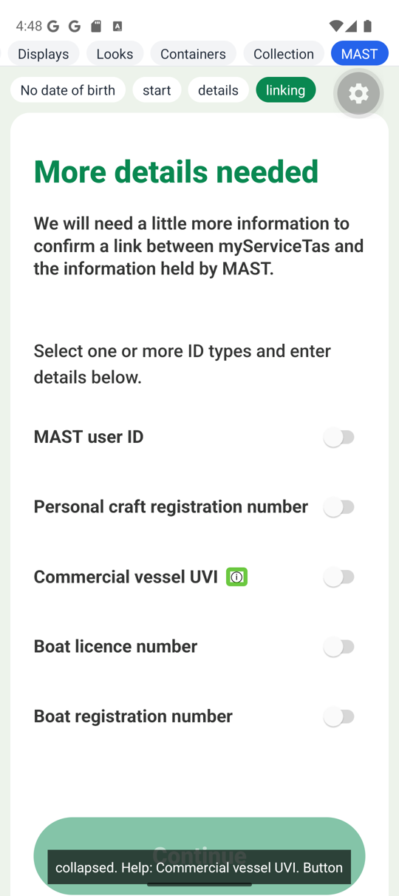 | 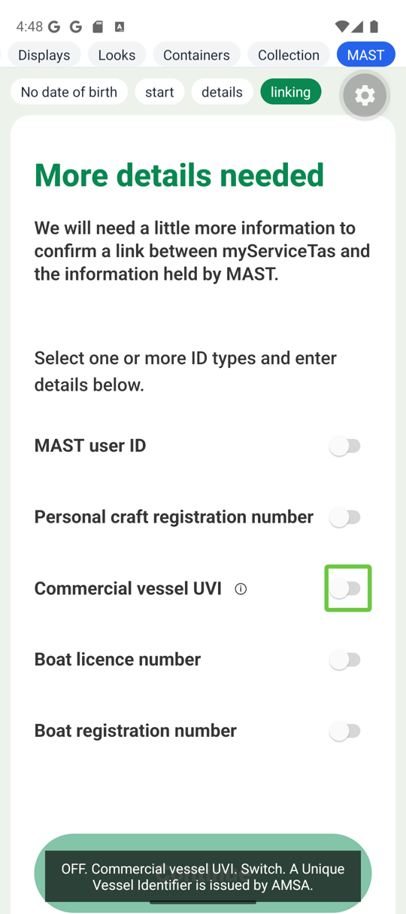 | 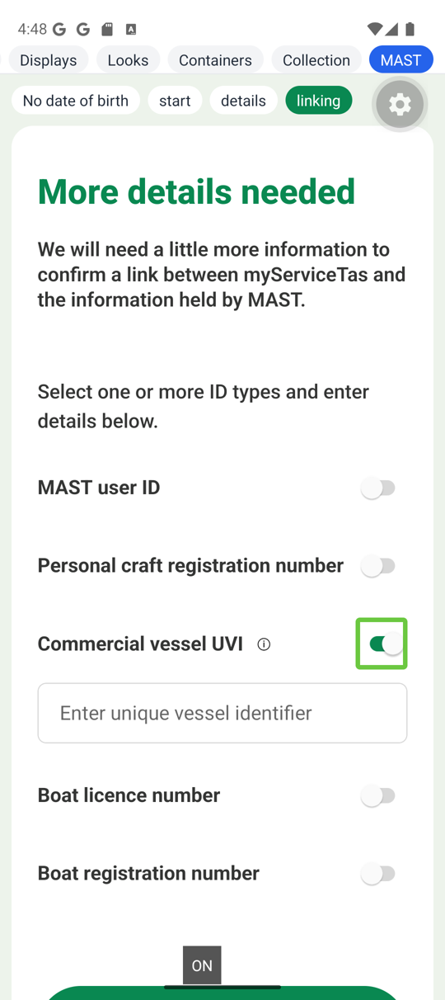 |
| **"collapsed. Help: Commercial vessel UVI. Button"** | **"OFF. Commercial vessel UVI. Switch. A Unique Vessel Identifier is issued by AMSA."** | **A double-tap: "ON"** |

**The heading level.** `NativeContents` hands React Native `role="heading"` and
`aria-level={p.headingLevel}` (`native.tsx:849–850`). Android's accessibility node has a
heading flag and no level, so TalkBack can say "Heading" and nothing more. Nothing for the library
to do on Android; the level still reaches the web through react-native-web.

**One thing that isn't forms.** Twice the app jumped to the playground's "Options" tab. TalkBack's
first focus, when it starts, lands on `App.tsx`'s first chip, and the next double-tap activates
it. That's the playground's tab row, which remounts the screen.

## 3. The worklist

| alpha.7 gap | alpha.8 | result |
|---|---|---|
| Q1 the native switches Android's blue | `checkbox.switchColors` | **Closed, fits.** One entry, four colours, the values traced to the html theme (§1). The tracks match exactly; the thumb is Android's 98% of white. |
| Q2 a field disabled and enabled again stayed disabled on Android | Fixed in forms-native | **Closed on the device.** With `disableType="global"` and no local patch: the refused Continue focuses with the keyboard up, the input and radios `enabled="true"`, typing lands. |
| Q3 no check short of a device | The device pass in rxc's plan | **Closed, run.** Every check passed on the MAST pages (§1). The plan's TalkBack line needs a person, and turned up R1. |
| §3 the docs didn't name icon and image variants | `HtmlTheme`'s paragraph names them (`forms-html` `theme.tsx:36–61`) | **Closed.** The theme already matches the new bullet: `icon.className` is `inline-flex`, and the 24px is on `icon.variants.note`; `image.className` is `block max-w-full`, the corners on `image.variants.illustration`. |
| TalkBack, open since alpha.6 | — | **Settled** (§2). The questions are not spoken (R1); headings have no level on Android; the help button, the switch and its toggle are right. |
| P9's open half: does a TalkBack double-tap on a switch's label toggle it? | — | **No, and it needn't.** The label is hidden from accessibility on purpose (`native.tsx:229–236`): the switch carries the name, so TalkBack has one stop per row, named and toggled by double-tap. A touch on the words doesn't find the switch, though: see R2. |

## 4. New gaps

### R1. forms-native: a radio group's question isn't spoken on Android

The shell hides every field label from accessibility (`native.tsx:229–236`): "the control
carries the name", so the label isn't read twice. That holds for a control named after its label:
a text input, a switch, a select. A radio group is different:
- **The name sits on the group `View`:** `role="radiogroup"`, `aria-label` from the question,
  and `aria-labelledby` (`native.tsx:565–568`).
- **Each option is named by its own words** (`aria-label={plainText(o.name)}`,
  `native.tsx:583`).
- **On Android the group's name reaches no one.** No node in the tree carries the question
  (§1). TalkBack doesn't stop on the group and doesn't say its name when moving onto an option.

So the question is said nowhere. On page 2, three yes/no questions with the same two answers are
read as "Yes it matches, No, I need to update my profile", three times. The check-list group
(`role="group"`, `native.tsx:633–636`) is built the same way; it wasn't on these pages, so it
wasn't tried.

The group's help text has the same problem, though less of it. Its hint (`fieldA11y`'s
`accessibilityHint`, `native.tsx:154`) sits on the same `View`. The visible help `Text`
(`native.tsx:309`) isn't hidden, so it can still be reached as its own stop, after the options.

- **Why the suites missed it:** react-native-web draws the group as a `div role="radiogroup"`
  named by `aria-labelledby`, which a browser's screen reader announces on entering the group.
- **Done instead:** nothing. The pages are unchanged; on the device, a TalkBack user hears the
  options without their question.
- **Suggest:** for a group of options on native, don't hide the label. Leave the question's
  `Text` in the tree as a stop before the options (it is the group's name, and no option repeats
  it), and hang the group's hint on it. A test would sit beside `disabledViews.test.tsx` and pin
  the props: the group label isn't `importantForAccessibility="no-hide-descendants"`. Then a
  device pass with TalkBack: the question read before "Yes it matches".

### R2. forms-native: touching a switch's label finds nothing for TalkBack

The pressable label (P9) works for a finger, but it's out of the accessibility tree
(`native.tsx:229–236`). So under explore-by-touch, a touch on "Boat licence number" focuses
nothing, and a double-tap does nothing. The switch at the row's far end is the only target. On a
phone that's a small target, and the words a sighted user would touch are dead to a TalkBack user.

- **Done instead:** nothing. A TalkBack user who swipes reaches the switch, named and togglable.
- **Suggest:** for a checkbox or switch with its label beside it, make the row the accessible
  element: one `accessible` view carrying the switch's role, name, state and press, with the
  label and the `Switch` inside it hidden. A touch anywhere on the row then lands on it, which is
  what the web's `<label>` gives. The help button would stay its own stop.

## 5. The web

Nothing changed on the web side: the published runtime is identical (Verdict), and ServiceTas's
web source is unchanged since `452aa158`. A regression pass, measured from same-origin iframes at
1440×1000 and 375×812, v2 (`?path=mast-eoi-v2`) and JSON (`?path=mast-eoi`), `&step=0`–`8`:

| | result |
|---|---|
| Horizontal overflow | **None.** No element past the viewport's right edge, on any of the 36 page-and-width pairs |
| The start page at 1440 | The image at (934, 472), 319 × 240, the same as alpha.7's §5 |
| The heading outline | As alpha.7: the shell's `h1`, each page title at 2, groups at 3, task-card titles at 4 |

**Console:**
- **v2 under html:** only ServiceTas's known noise: "Cannot update `PageContent` while rendering
  `Reactive`" and `console.log(undefined)`.
- **The JSON version** adds "Cannot update `DefaultVisibility` while rendering
  `RenderFormNode`", from `@react-typed-forms/schemas`, as before.
- **v2 under Ant** (`?path=mast-eoi-v2-antd`): one dev warning per unnamed role (`stats`,
  `actionRequired`, `taskCard`, `footer`, `notice`, `illustration`, `pageTitle`, `lead`,
  `statLabel`, `statValue`, `taskNumber`, `tag`, `progress`, `inlineLink`), as known.

## 6. Against alpha.7

| alpha.7 suggestion | now |
|---|---|
| Q1 `checkbox.switchColors` | **Fixed,** and fits. |
| Q2 a boolean for every native setter | **Fixed;** checked on the device with no patch. |
| Q3 a device pass before a forms-native alpha | **Fixed;** run here over the MAST pages. Its TalkBack line found R1. |
| §3 name icon and image variants in the docs | **Fixed;** the theme already matched. |
| "The next run should have someone swipe through" | **Done,** by click-to-explore and Alt + arrows, since a mouse can't swipe fast enough. |

**What alpha.7 got wrong:**
- **"Whether the radio group is announced by its question" could have been answered from the
  tree.** alpha.7 recorded each radio named by its option and no node named by the question. With
  the label hidden from TalkBack by design, nothing was left to say the question.
- **"`uiautomator` doesn't show heading roles or levels."** True, but there's no level to show:
  Android's node has a heading flag and no level.

## Compat and the engine

- **Versions:**
  - `@rx-controls/forms-react` / `forms-html` / `forms-antd` pinned to `0.1.0-alpha.8`, in
    `client-common` and `sites/portal`;
  - `@react-typed-forms/core` `^5.1.5` and `@rx-controls/react` `^1.1.5`, unchanged.
- **The lockfile** holds one `@rx-controls/core@1.1.4` and one `@rx-controls/react@1.1.5`.
- **The alpha.7 source type-checked against alpha.8** before any change, on the web and on
  native. Nothing broke.
- **Type-checks and builds:**
  - `client-common` and `sites/portal` type-check with no errors, and the portal builds;
  - rxc's `apps/native-dev` type-checks (`rushx build`) with the copies in place.

## What landed

- **ServiceTas `trial/codefirst-mast-eoi-alpha8`** (not pushed): the bump (`859d0aa1`) and the
  switch colours (`3833dd26`).
- **rxc:** this report and its screenshots.
- **Not in either repo:**
  - the copies in `apps/native-dev/src/mast/` (excluded);
  - the "MAST" entry in `App.tsx`, reverted after the run.
